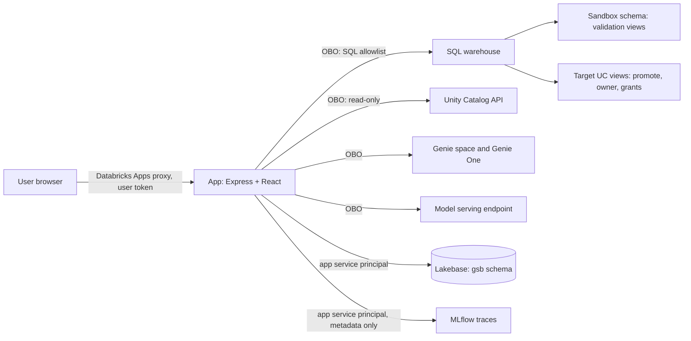

# STS Semantics Builder

A Databricks App that helps data teams design, validate, optimize, publish and govern Unity Catalog
**metric views**. An LLM advisor helps at each step. A person reviews and approves each change before it runs.

- **Who it is for:** data engineers, analytics engineers and BI leads who own business KPIs.
- **What you get:** one governed metric view per KPI area (for example Revenue or Returns), validated in a
  sandbox, tested with Genie, promoted to Unity Catalog with its owner and grants, and checked for drift.
- **How it runs:** every data read and every change runs as the signed-in user (on-behalf-of), never as the app.

## Contents

- [Modules](#modules)
- [How to use the app](#how-to-use-the-app)
- [Security model](#security-model)
- [Architecture](#architecture)
- [Prerequisites](#prerequisites)
- [Configure and deploy](#configure-and-deploy)
- [Local development](#local-development)
- [Tests](#tests)
- [Project structure](#project-structure)
- [Limits and known gaps](#limits-and-known-gaps)
- [Design notes](#design-notes)

## Modules

| Module                    | What it does                                                                                                                                                                                    | Status    |
| ------------------------- | ----------------------------------------------------------------------------------------------------------------------------------------------------------------------------------------------- | --------- |
| Projects and sub-projects | A project groups related KPI areas. A sub-project builds one metric view.                                                                                                                       | Available |
| Sources & Readiness       | Pick UC tables, find how they relate, score readiness, review and apply metadata fixes (comments, keys, tags) as SQL you approve.                                                               | Available |
| Intent & Context          | Draft a Semantic Brief (goal, audience, questions, measures, dimensions) with AI, edit it, and confirm it.                                                                                      | Available |
| Metric dictionary         | Import certified definitions (Excel, CSV, Markdown, or a UC volume file) that every sub-project reuses.                                                                                         | Available |
| Modeling patterns         | Try common metric patterns (ratios, windows, semi-additive) on your tables.                                                                                                                     | Available |
| Metric Designer           | Generate a design with AI or start from a template, edit fields in tables or as YAML, see the join diagram, write tests, validate in the sandbox, and keep every change as a version.           | Available |
| Optimize                  | Best-practice checks, stress test, materialization suggestions with a sandbox try, cost and a monthly budget, and Ask Genie (a Genie space, or Genie One). A Genie agent score (9 rule checks) with the place to fix each gap, and Optimize with benchmarks: the AI suggests one change for a wrong answer, you approve it, and the app keeps it only if the accuracy goes up. | Available |
| Publish                   | A left pane with five tasks: Promotion (promote a validated version, restore an older one), Governance (owner and read grants), Dashboard (a starter AI/BI dashboard and the command that creates it), Drift, and Pages.                                               | Available |
| Pages for Discover        | Draft UC Semantics Pages from the certified dictionary, the brief glossary and the metric view. Pick the domain, edit the Pages, download one file, and copy the Genie Code bulk import prompt. | Available |
| Metric views library      | All your metric views, their promoted and latest versions, and health. Import a metric view made outside the app.                                                                               | Available |
| Genie chat                | The **Genie** header button opens a side panel on every sub-project page: chat with Genie Agent (follow-ups, SQL, a small result table) or Genie One on the sandbox view. **Use as a test** adds the question as a test. | Available |
| Genie agent               | On the project page: one production Genie space on the promoted views of the sub-projects you choose, with their briefs, tests and kept changes. The app makes the CAN RUN command for the audience. | Available |
| Legacy import             | New, Import a legacy model: dbt MetricFlow (YAML or semantic_manifest.json) or LookML (views and explores) to a draft metric view in a new sub-project, by rules. Each field keeps its source definition and a status (converted, check it, not converted). | Available |
| Golden project            | On the project page: the gates from certified tables to an approved, promoted view, Genie accuracy of 85% or more, and an up-to-date project Genie agent. | Available |
| Data certification        | Sources & Readiness, **Certification**: read-only data checks (rows, freshness, nulls, empty strings, constant columns), a named reviewer approves the tables, then you set the governed tag `system.certification_status = certified` with SQL you examine. | Available |
| Reviews                   | Promote can need approval. The author names a reviewer by email; the reviewer sees that version read-only (impact, tests, YAML, SQL) and approves or rejects it.                                | Available |
| Discover and consolidate  | Scan schemas for metric views and SQL views, group the same KPI across views, show formula conflicts, propose one definition, import it, or add it to a dictionary as certified.                | Available |
| Drift and health          | Schema, definition, governance, usage and data (opt-in totals) drift. Runs on demand and once a day when you open the app.                                                                      | Available |

## How to use the app

A typical path for one KPI area. Each page shows the next step.

1. **Projects > New project.** Name it and describe the business goal.
2. **New sub-project.** One sub-project is one metric view, for example "Revenue".
3. **Sources & Readiness.** Pick the tables in the Unity Catalog tree. Click **Assess sources**. Review the
   improvement plan. To apply a fix, review the exact SQL and approve it. It runs as you.
4. **Intent & Context.** Click **Generate brief**, ask for changes in the chat, then **Confirm brief**.
   Use **Suggest the empty sections with AI** to fill gaps.
5. **Metric Designer.** Click **Generate design** (AI), or **Start from a template** (no AI). Then:
   - **Edit fields** to change measures and dimensions in tables, or add a field by hand.
   - **Tests**: the questions the view must answer. **Edit tests by hand** if needed. A test compares the view
     with plain SQL, or checks one measure against an **expected value** with a tolerance, for example "Net
     Revenue where Customer Region = ASIA = 218,400,000,000 +/- 0.5%" from the legacy report. Promote needs a
     validated version, so every test must pass first.
   - **Validate** creates the view in the sandbox schema and runs the tests. **Fix with AI** helps when a
     test fails.
   - **History** lists every version. **Restore** copies an old version as a new one.
6. **Optimize.** Fix best-practice findings, run a stress test, try materialization in the sandbox, and set
   a monthly budget. In **Ask Genie**, create a Genie space on the sandbox view, pick the expected fields for
   each business question, and click **Ask Genie** or **Ask Genie One**. The app checks the fields in the SQL.
   The space gets its settings from the design (instructions from the brief, sample questions, example SQL and
   benchmarks from the tests); the dialog shows the JSON before it runs.
   At any step, click **Genie** in the header to chat about the sandbox view. **Use as a test** opens the
   question as a new test in Metric Designer, Tests. The app stores no question or answer.
7. **Publish.** In **Promotion**, set the target view (`catalog.schema.view`, not the sandbox), then
   **Promote**. The Promote dialog shows the **Impact**: the fields that this version removes, renames or
   changes against the view in UC, and who read the view in the last 90 days (Genie spaces, dashboards, jobs,
   notebooks, queries, ad hoc SQL), with the changed fields each one read. It needs SELECT on
   `system.access.table_lineage` and `system.access.column_lineage`; without it, the dialog shows the field
   changes only. To need approval first, check **Promote needs approval by another person**, then **Ask for
   approval** with the reviewer's email, and send them the review link (the app sends no email). The reviewer
   opens **Reviews**, checks the version read-only, and approves or rejects it with a comment. Promote runs only
   for the approved version. In **Governance**, set the owner and read grants. In **Drift**, **Check drift** compares UC with
   the promoted version. In **Pages**, download the Pages, then click **Open Discover** and **Copy the prompt**
   for Genie Code bulk import. **Overview** shows the status of each step in the About box.
8. **Metric views (left nav).** See every view and its health. **Import a metric view** made outside the app,
   or **Discover and consolidate KPIs** across schemas.

To roll back: restore an older version in History, validate it, then promote it.

### Demo data

The dev target uses copies of `samples.tpch`, `samples.bakehouse`, `samples.tpcds_sf1` and `samples.wanderbricks`
in a catalog you own, because `samples` is read-only and metadata fixes fail there with `PERMISSION_DENIED`:

```sql
CREATE TABLE <catalog>.<schema>.orders AS SELECT * FROM samples.tpch.orders;
```

Apply primary keys before the foreign keys that reference them.

## Security model

- **User identity for data.** Warehouse queries and model calls run on behalf of the signed-in user (OBO).
  Catalog, schema and table pickers list only what that user can access. Production fails closed
  without the user headers from the Databricks Apps proxy.
- **App identity for metadata only.** The app service principal owns the Lakebase `gsb` schema
  (projects, briefs, reports, fixes, audit log), writes MLflow traces, and lists the published Discover domain
  names for Pages (apps cannot get the `domains` user scope). It never reads customer data.
- **One path to the warehouse.** Every statement passes an allowlist (reads, `DESCRIBE`, and a fixed set
  of metadata DDL: comments, keys, tags, metric views, read grants and revokes, and the owner of a view). One statement at a time, no comments.
- **The model never writes SQL.** It proposes names and text. The server checks names against the real
  table, quotes every identifier and literal, and builds the statement.
- **Exact SQL, human approval.** A fix runs only with the statements the user reviewed. It runs once,
  as the user, and is written to an append-only audit log before and after execution.
- **No content in telemetry.** Logs and MLflow traces hold prompt id and version, latency, tokens and
  outcome. Prompts, responses and catalog details stay inside the app.
- **Reviews are narrow and audited.** A reviewer sees only the version they were asked about, read-only, and
  cannot open the sub-project. The author cannot approve their own version. Impact on the review page runs with
  the reviewer's own Unity Catalog rights. Every request, cancel and decision goes to the audit log.
- **Validation stays in a sandbox.** Draft metric views are created only in the schema set by the
  `sandbox_schema` bundle variable, never in a name from the request. Tests are reads. Only pass or fail,
  row counts, the difference in percent for expected values, and the SQL are stored, never result values.
- **Untrusted input stays data.** User text and catalog metadata go to the model inside delimited
  `untrusted_data` blocks. Model output is validated against a schema and repaired once at most.

## Architecture



- **Frontend:** React, TypeScript, Vite, React Router, Du Bois (`@databricks/design-system`), and React Flow
  (`@xyflow/react`, MIT, by webkid GmbH) for the lineage canvas.
- **Backend:** Node.js, Express, Databricks AppKit (`@databricks/appkit`), Zod for every request body.
- **State:** Lakebase Postgres, schema `gsb` (projects, briefs, designs and versions, checks, audit log).
  Migrations in `server/db/migrations` run on start.
- **AI:** one serving endpoint (default `databricks-claude-sonnet-5-5`). Prompts and outputs are validated
  against schemas. Traces hold metadata only.

## Prerequisites

- Node.js 22 or later, and pnpm.
- Databricks CLI 1.0 or later, signed in with OAuth (`databricks auth login --profile <PROFILE>`).
- A workspace with Unity Catalog, a serverless SQL warehouse, a Lakebase project, and a model serving endpoint.
- A sandbox schema (`catalog.schema`) where app users have `USE SCHEMA` and `CREATE TABLE`.
- To promote: `CREATE TABLE` and `USE SCHEMA` in the target schema, and `SELECT` on the source tables.

### App scopes (user authorization)

The app calls Databricks as the user. The bundle sets these scopes in `user_api_scopes`:

| Scope                                                                  | Used for                                       |
| ---------------------------------------------------------------------- | ---------------------------------------------- |
| `sql`                                                                  | Warehouse queries, approved DDL, Query History |
| `model-serving`                                                        | Model calls                                    |
| `catalog.catalogs:read`, `catalog.schemas:read`, `catalog.tables:read` | UC pickers and metadata                        |
| `genie`                                                                | Ask Genie (Genie space) and Ask Genie One      |

Each `databricks apps deploy` (bundle) **replaces** the scopes with the list in `databricks.yml`. Add a scope
there, not only with `databricks apps create-update`, or the next deploy removes it. After a scope change,
each user consents again on their next visit.

## Configure and deploy

The app command, environment and resources live in `databricks.yml` (`resources.apps.app.config`). A bundle
config replaces `app.yaml`.

| Variable                               | Meaning                                                                         |
| -------------------------------------- | ------------------------------------------------------------------------------- |
| `sql_warehouse_id`                     | Serverless SQL warehouse the app uses                                           |
| `postgres_branch`, `postgres_database` | Lakebase resource names (`databricks postgres list-branches`, `list-databases`) |
| `serving_endpoint_name`                | Model serving endpoint                                                          |
| `sandbox_schema`                       | `catalog.schema` for validation views                                           |

Deploy (the workspace host comes from the CLI profile):

```bash
pnpm install
pnpm run build
databricks apps deploy --target dev --profile <PROFILE> --var sql_warehouse_id=<WAREHOUSE_ID>
```

For production, set the `prod` target variables, then deploy with `--target prod`. The first deploy creates
the app service principal. It owns the `gsb` schema in Lakebase, so deploy before you run the app locally.

To start a stopped app without a deploy: `databricks apps start semantics-builder --profile <PROFILE>`.

## Local development

```bash
cp .env.example .env   # set DATABRICKS_HOST, the Lakebase settings and the variables above
pnpm install
pnpm run dev
```

Production fails closed without the user headers from the Apps proxy, so local runs use your own CLI identity.

## Tests

```bash
pnpm run typecheck
pnpm run lint
pnpm test                 # unit tests (Vitest)
```

The `*.pg.test.ts` tests run only with a throwaway Postgres database. They drop and recreate the `gsb` schema, so
run them one file at a time:

```bash
TEST_DATABASE_URL='postgres://localhost/<throwaway_db>?sslmode=disable' pnpm exec vitest run --no-file-parallelism
```

End-to-end tests (Playwright) run against a deployed app in a signed-in Chrome:

```bash
pnpm e2e:profile          # opens Chrome with a test profile on port 9333; sign in and leave it open
E2E_BASE_URL=https://<app-url> pnpm exec playwright test
```

Playwright attaches over CDP because a Chrome that Playwright starts cannot pass the workspace sign-in. The
tests create projects named `E2E ...` and delete them at the end.

## Project structure

```
client/src/
  App.tsx            Shell, left nav, routes
  pages/             Projects, project, Sources, Intent, Modeling patterns, Designer, Optimize, Library
  components/        Panels (promote, govern, drift, Genie, discover, dictionary, ...)
server/
  server.ts          AppKit setup, route registration
  api/               Express routes, one file per area
  db/migrations/     Lakebase schema (gsb), applied on start
  sql/               Statement allowlist and runner (as the user)
  uc/                Unity Catalog reads (as the user)
  readiness/ designer/ optimize/ dictionary/ discover/ drift/ genie/ llm/ patterns/ permissions/
shared/              Types and Zod schemas used by client and server
tests/e2e/           Playwright scenarios
docs/                Phase plans and decisions
databricks.yml       Bundle: app, resources, scopes, targets
```

## Third-party software

The app builds on open-source packages under their own licenses (Apache-2.0, MIT, ISC). The list, with credits,
is in the repository [`LICENSE-THIRD-PARTY.md`](../../LICENSE-THIRD-PARTY.md#dw-migrationsemantics-builder). The
lineage canvas uses React Flow and keeps its attribution link.

## Limits and known gaps

- Ask Genie checks the fields that Genie's SQL uses. It does not yet compare result values.
- Genie One is not bound to a space. The app names the sandbox view in each question, and the answer shows if
  Genie One also searched workspace knowledge snippets that other users wrote.
- Discover reads metric views and SQL views only. Dashboards, Genie instructions, dbt and LookML come later.
- Impact analysis comes from lineage, which does not record every read, so it can miss a consumer. It shows
  counts and ids, not user names or query text.
- Drift checks run on demand and once a day when you open the app. No unattended scheduled job yet.
- Pages and Genie Code have no API, so the app cannot create Pages itself. The app writes a file and a prompt for
  Genie Code bulk import, which creates draft Pages. A domain curator
  publishes them. Apps cannot get the `domains` user scope, so the app service principal lists the published
  domains. Give it `MANAGE DISCOVER` (Discover > Manage Domains > Permissions); without it, users type the domain
  name.
- Owner transfer is blocked for a materialized view (set the owner before you materialize).

## Design notes

For a detailed guide to how the app works, read the [wiki](docs/wiki.md).

The phase plans and their decisions are in [`docs/`](docs):
[metric designer](docs/phase-b-metric-designer.md),
[playground](docs/phase-c-playground.md),
[experience](docs/phase-c2-experience.md),
[sources first](docs/phase-c3-sources-first.md),
[dictionary](docs/phase-c4-dictionary.md),
[manual paths and Genie](docs/phase-c5-manual-genie.md),
[optimizer](docs/phase-d-optimizer.md),
[library, import, promote](docs/phase-e-library-import-promote.md),
[migration and drift](docs/phase-g-migration-drift.md).
