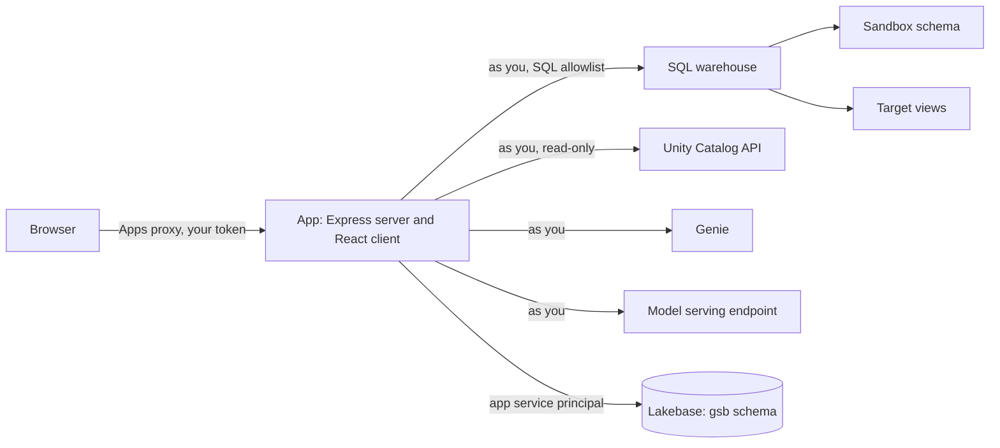

# STS Semantics Builder: how the app works

This wiki tells how the app works, step by step. It uses ASD-STE100 Simplified Technical English.

For the configuration and the deployment, read the [README](../README.md). For the design decisions, read the
phase documents in this folder.

## Contents

1. [What the app does](#1-what-the-app-does)
2. [Words that this wiki uses](#2-words-that-this-wiki-uses)
3. [Identity and access](#3-identity-and-access)
4. [The parts of the app](#4-the-parts-of-the-app)
5. [Projects and sub-projects](#5-projects-and-sub-projects)
6. [Overview](#6-overview)
7. [Sources & Readiness](#7-sources--readiness)
8. [Intent & Context](#8-intent--context)
9. [Metric dictionary](#9-metric-dictionary)
10. [Modeling patterns](#10-modeling-patterns)
11. [Metric Designer](#11-metric-designer)
12. [Tests and validation](#12-tests-and-validation)
13. [Optimize](#13-optimize)
14. [Ask Genie](#14-ask-genie)
15. [Publish: Promotion](#15-publish-promotion)
16. [Impact analysis](#16-impact-analysis)
17. [Approvals and Reviews](#17-approvals-and-reviews)
18. [Publish: Governance](#18-publish-governance)
19. [Publish: Drift](#19-publish-drift)
20. [Publish: Pages](#20-publish-pages)
21. [Metric views library](#21-metric-views-library)
22. [The SQL path and its safety rules](#22-the-sql-path-and-its-safety-rules)
23. [The AI advisor](#23-the-ai-advisor)
24. [The data that the app keeps](#24-the-data-that-the-app-keeps)
25. [Permissions that users need](#25-permissions-that-users-need)
26. [Limits](#26-limits)
27. [Troubleshooting](#27-troubleshooting)

## 1. What the app does

The app helps a data team make Unity Catalog metric views. A metric view is a Unity Catalog view. It has a YAML
definition with measures (for example Net Revenue) and dimensions (for example Customer Region).

The app does these tasks:

- It helps you select the source tables, and it finds the problems in their metadata.
- It helps you write a business brief: the goal, the audience, the questions, the measures and the dimensions.
- It makes a design of the metric view, with AI or from a template.
- It tests the design in a sandbox schema.
- It measures the speed and the cost of the design, and it tests the design with Genie.
- It puts the metric view in Unity Catalog, with an owner and read grants.
- It finds the changes that other persons make to the view after that.

A person must examine and approve each change before it runs. The AI does not change data or metadata.

## 2. Words that this wiki uses

| Word | Meaning |
| --- | --- |
| Project | A group of related KPI areas, for example "Order fulfilment". |
| Sub-project | One KPI area in a project. One sub-project makes one metric view. |
| Brief | The Semantic Brief. It tells what the metric view must show and for whom. |
| Design | The YAML of the metric view. Each change makes a new version of the design. |
| Version | One saved state of the design. A version does not change after you save it. |
| Sandbox schema | A schema for tests only. The app makes draft views there. The bundle variable `sandbox_schema` sets it. |
| Sandbox view | The draft metric view in the sandbox schema. |
| Target view | The real view in Unity Catalog (`catalog.schema.view`). |
| Promote | The step that puts a validated version in the target view. |
| Validated | All the tests of the version passed in the sandbox. |
| Consumer | A Genie space, dashboard, job, notebook, query, alert or app that reads the view. |
| Reviewer | A person that the author names to approve a version before Promote. |
| Audit log | A table that keeps a record of each change: who, what, when and the result. |

## 3. Identity and access

### 3.1 Two identities

The app uses two identities. Each identity has a different job.

| Identity | What it does |
| --- | --- |
| You (the signed-in user) | All data reads, all SQL, all Unity Catalog reads, all model calls and all Genie calls. |
| The app service principal | It keeps the app data in Lakebase (schema `gsb`). It writes MLflow traces with metadata only. It reads the list of published Discover domains for Pages. |

The app service principal never reads customer data.

### 3.2 On-behalf-of access

The Databricks Apps proxy sends your token to the app. The app uses this token for each call to Databricks. Thus
the app can do only the things that you can do. Unity Catalog permissions apply as usual.

If the proxy does not send your identity, the app stops the request. It does not use the service principal
instead.

### 3.3 Scopes

The app asks for these scopes when you sign in for the first time:

| Scope | Why the app needs it |
| --- | --- |
| `sql` | Queries on the SQL warehouse, approved DDL, Query History |
| `model-serving` | Calls to the model for the AI advisor (it replaces the deprecated `serving.serving-endpoints`) |
| `catalog.catalogs:read`, `catalog.schemas:read`, `catalog.tables:read` | The Unity Catalog pickers and table metadata |
| `genie` | Ask Genie and Ask Genie One |

When the scopes change, you must give your consent again on your next visit.

### 3.4 Who sees a project

A project is private. Only the person who made the project can see it and change it. The only exception is a
review: a reviewer can see one version of one sub-project, read-only. Refer to
[Approvals and Reviews](#17-approvals-and-reviews).

## 4. The parts of the app

### 4.1 The screen

- **The left navigation** has **All projects**, **Metric views**, **Reviews** and the list of your projects.
  When a person asks you for a review, the Reviews item shows the number of open reviews.
- **The header** has the app name, the **Genie** button and the theme selector (light, dark or system). The
  Genie button is available on the pages of a sub-project. Refer to 14.1.
- **A sub-project** has these tabs, in order: Overview, Sources & Readiness, Intent & Context, Metric Designer,
  Optimize and Publish. A green mark shows a tab that is complete.

### 4.2 The system

- The client is React with the Databricks design system (Du Bois).
- The server is Node.js with Express and Databricks AppKit.
- The app keeps its data in Lakebase Postgres, in the schema `gsb`. The app applies the database migrations
  when it starts.

## 5. Projects and sub-projects

A project is a group. A sub-project does the work. Each sub-project makes one metric view.

To make a project:

1. Click **All projects**.
2. Click **New project**.
3. Type a name and the business goal.
4. Click **Create project**.

A project page has four tabs: **Sub-projects**, **Golden project**, **Genie agent** and **Metric dictionary**. The
**New** menu has **New sub-project**, **New Genie agent** and **Metric dictionary**; the last two open their tabs.

To make a sub-project:

1. Open the project.
2. Click **New**, then **New sub-project**.
3. Type a name, for example "Net revenue".
4. Click **Create sub-project**.

To delete a project, open the project and click **Delete project**. The app shows the sandbox views of the project. You
can remove these views before the app deletes the project. The app does not remove the target views in Unity
Catalog.

### 5.0 Import a legacy semantic model

**New**, **Import a legacy model (dbt)** makes a new sub-project from a dbt MetricFlow model. Choose a YAML file
with `semantic_models` and `metrics`, or the `semantic_manifest.json` that `dbt parse` writes. For YAML, type the
catalog.schema of the dbt models: `ref('orders')` becomes `<catalog.schema>.orders`. The manifest has the tables.

Click **Preview**. The app converts the model by rules, with no AI:

| dbt | Metric view |
| --- | --- |
| The semantic model with the most measures that the metrics use | The source table |
| A foreign entity that is the primary entity of another semantic model | A join, `source.<fk> = <model>.<pk>` |
| A dimension | A dimension; on a joined model, `<model>.<column>` |
| A simple metric | `SUM`, `COUNT`, `COUNT(DISTINCT)`, `AVG`, `MIN`, `MAX`, `MEDIAN` or `PERCENTILE_CONT` of the measure, with `FILTER (WHERE ...)` for a filter |
| A ratio metric | `MEASURE(numerator) / NULLIF(MEASURE(denominator), 0)` |
| A derived metric | Its expression with `MEASURE()` for each metric (check it) |
| A cumulative, conversion or offset metric | Not converted: add it as a window measure by hand |

Each field gets a status: **Converted**, **Check it** or **Not converted**, and keeps its dbt definition in its
note in the Metric Designer. The dbt name becomes a synonym. Fields that are not converted go to the open questions
of the brief. A semantic model that does not join to the fact is left out. Click **Create the sub-project**, then
validate the draft: its tests compare it with plain SQL.

The file is only read. The app does not run it, and it does not read the tables until you validate.

**LookML.** Choose the `.view.lkml` files and the model file with the explore; the app reads them as one. Type the
default catalog.schema: a table name `schema.table` gets the catalog, and `table` gets both.

| LookML | Metric view |
| --- | --- |
| The view of the first explore (or `from:`) | The source table (`sql_table_name`) |
| A join of the explore with `sql_on` | A join; `${orders.customer_id}` becomes `source.o_custkey` |
| A dimension | A dimension; `${TABLE}` and `${field}` references are replaced |
| A dimension group of type time | One dimension for each of the date, week, month, quarter and year timeframes, with `DATE_TRUNC` |
| A count, sum, average, min, max, median, percentile or count_distinct measure | The aggregation, with `FILTER (WHERE ...)` for `filters: [field: "value"]` |
| A number measure | Its SQL with `MEASURE()` for each measure it uses |
| Liquid (``, `{{ }}`), Looker filter expressions (`-x`, `>10`, `%x%`), derived tables, list and other types | Not converted |

Hidden dimensions and primary keys are not added as dimensions, but other fields can still use them. A join that is
not many-to-one gets a warning: measures across it can count rows more than once.

**Power BI and SSAS Tabular.** Choose a Power BI template (`.pbit`, up to 600 KB), the `.tmdl` files of a Power BI
project (all the files of the `definition` folder and its `tables` folder, chosen together), or an SSAS Tabular model
(`.bim`).
Both hold the same TMSL model.

| Tabular | Metric view |
| --- | --- |
| The table on the many side of the most relationships | The source table |
| A relationship from that table | A join; second-level relationships get a warning |
| The table source in Power Query | A Databricks connector (`Databricks.Catalogs`) gives catalog, schema and table. Else the default catalog.schema and the source item name, with a warning to check it |
| A visible text, date, boolean or key column | A dimension, on its source column |
| SUM, AVERAGE, MIN, MAX, MEDIAN, DISTINCTCOUNT, COUNT, COUNTA, COUNTROWS, DIVIDE, CALCULATE with column filters, IF, BLANK, arithmetic and [measure] references | SQL by rules |
| Other DAX (iterators such as SUMX, VAR) | The AI suggests SQL, marked **Check it**. It gets the DAX and the column and measure names, never data |
| Time intelligence (TOTALYTD, DATEADD), ALL, calculated columns | Not converted |

The preview shows the AI SQL. **Create the sub-project** uses that same SQL; the AI does not run again. The server
rejects AI SQL with a statement, a subquery or a comment. Validate runs it in the sandbox. Add a test for each
measure marked **Check it**: the tests that the app makes check only the first measure.

**Tableau.** Choose a workbook (`.twb`) or a data source (`.tds`), or a packaged file (`.twbx`, `.tdsx`, up to 7.5
MB; save without extracts if it is larger). The app reads only the XML; a DOCTYPE or an entity declaration is refused.

| Tableau | Metric view |
| --- | --- |
| The first data source with tables, and its first table | The source table; the Databricks connection gives the catalog |
| A join clause, or a relationship of the object model, from the first table | A join |
| A text, date or boolean column | A dimension (keys and hidden columns are left out) |
| A numeric column | A measure with its default aggregation (Sum, Avg, Count, CountD, Min, Max, Median) |
| A calculation with SUM, AVG, MIN, MAX, MEDIAN, COUNT, COUNTD, ZN, IIF, IF/ELSEIF/ELSE/END, CASE, ISNULL, IFNULL, ABS, ROUND, UPPER, LOWER, TRIM, LEN, CONTAINS, DATETRUNC and references | SQL by rules. A row-level measure is summed, and marked **Check it** |
| LOD expressions (`{FIXED ...}`) and table calculations (TOTAL, RUNNING_SUM, WINDOW_*) | The AI tries; most have no SQL form and are not converted |
| Custom SQL relations | Left out, with a warning |

**Cognos Framework Manager.** Choose the `model.xml` of the project, and type the default catalog.schema of the
tables (the table names come from the SQL of each database query subject; the app warns you to check them).

| Cognos | Metric view |
| --- | --- |
| The database query subject on the many side of the most relationships | The source table |
| A relationship of that query subject | A join |
| The query items of the business layer (or, with no business layer, of the database layer) | Fields: attributes are dimensions, facts are measures with their regular aggregate. Identifiers are left out |
| `total`, `average`, `minimum`, `maximum`, `count`, `count(distinct)`, `median`, `if () then () else ()`, `case`, `coalesce`, string functions and references | SQL by rules |
| Other functions (such as `running-total`), macros (`#...#`) and prompts (`?p?`) | The AI tries, marked **Check it**; else not converted |
| Regular and measure dimensions (DMR) | Not converted, with a warning |

**MicroStrategy.** Choose one JSON file with the objects of the REST Modeling API: the logical tables
(`/api/model/tables`), attributes, facts and metrics, in any arrays (each object keeps its `information.subType`).
Type the default catalog.schema of the tables (the app maps them by name and warns you to check them). The
`.mmp` packages of Object Manager cannot be read.

| MicroStrategy | Metric view |
| --- | --- |
| The table of the most facts | The source table |
| An attribute whose lookup table is another table, on its ID form | A join (one level; others are left out with a warning) |
| An attribute | A dimension from its report display form (or DESC, else ID); other forms are dimensions named `Attribute Form` |
| A fact | The row expression that metrics aggregate |
| `Sum`, `Avg`, `Min`, `Max`, `Count` (also `<Distinct=True>`), `Median`, `StDev`, `Var`, `If`, `NullToZero`, `ZeroToNull`, math and string functions, the report level `{~+}` and metric references | SQL by rules |
| Conditions (`<[Filter]>`), transformations, other levels, OLAP functions (`Rank`, `RunningSum`) and `ApplySimple` | The AI tries, marked **Check it**; else not converted |

**SSAS Multidimensional (best effort).** Choose the `.dsv`, `.dim` and `.cube` files of the project together (the
app reads them as one), or one database script (`.xmla`) from SQL Server Management Studio. Type the default
catalog.schema of the tables (the app maps the data source view tables by name and warns you to check them).

| SSAS Multidimensional | Metric view |
| --- | --- |
| The measure group with the most measures, and its table | The source table. Other measure groups are left out, with a warning |
| A regular dimension of that measure group, at its key attribute | A join on the key columns |
| A fact (degenerate) dimension | Dimensions on the source table |
| A dimension attribute | A dimension from its name column (or its one key column). Surrogate keys are left out |
| A measure with Sum, Count, Min, Max or DistinctCount | A measure |
| A calculated member of the MDX script with arithmetic, `IIF`, `IsEmpty`, `Divide`, `CoalesceEmpty` and measure references | SQL by rules |
| Semi-additive measures (`LastNonEmpty`, `ByAccount`), computed columns of the data source view, named queries, snowflake attributes, reference and many-to-many dimensions | Not converted, with a note or a warning |
| Other MDX (tuples, sets, `PrevMember`, `YTD`, `ParallelPeriod`) | The AI tries, marked **Check it**; else not converted |

### 5.1 The golden project

The **Golden project** tab of a project shows the path from certified data to a trusted Genie agent. The project gets
the **Golden** tag when all gates pass. The gates apply to each sub-project in the Genie agent of the project. Before
the agent exists, they apply to each sub-project with a promoted view.

| Gate | Pass when |
| --- | --- |
| The tables are certified | Each source table has the tag `system.certification_status = certified` (see [7.6](#76-the-certification-tab)). The app reads the tags as you. |
| The promoted version is approved | A reviewer approved the version that is in Unity Catalog (see [17](#17-approvals-and-reviews)). |
| The view is promoted | A version is in Unity Catalog. |
| Genie accuracy is 85% or more | The latest benchmark run of the promoted version has at least one benchmark, and 85% or more are correct (see [14.0.2](#1402-optimize-with-benchmarks)). Benchmarks run on the latest validated version, so run them, then promote that version. |
| The project Genie agent is up to date | The agent exists and has the settings of the promoted versions. |

Each gate that does not pass has **Open**, which goes to the page that fixes it. Click **Check again** after a change.

### 5.2 The Genie agent of a project

The production Genie agent belongs to the project, not to a sub-project. It is one Genie space on the promoted
views of the sub-projects that you choose. Choose related sub-projects, so Genie can answer questions across them.

1. Open the project, then the **Genie agent** tab. It lists each sub-project with a promoted view.
2. Select the sub-projects for the agent.
3. Click **Create the Genie agent**. Examine the space settings, then click **Create the agent**. The app creates
   the space as you, in your workspace folder.

The settings join the settings of each promoted version: the view, the brief, the tests, entity matching, and the
changes that Optimize with benchmarks kept. Each sub-project gets a section in the instructions, which starts with
"About <sub-project> (<view>):". The tag **Update it** shows when a promoted version, a kept change or your choice
of sub-projects changed. Click **Update the Genie agent** to replace all its settings.

To give the audience access, add groups (by name) or users (by email), then click **Make the CAN RUN command**. Run
the command in your terminal with the Databricks CLI, as you, or use **Share** in Genie. The app cannot do this
itself: apps cannot get the `access-management` scope that the permissions API needs. Each person also needs
SELECT on each promoted view (Governance of each sub-project) and CAN USE on the SQL warehouse.

## 6. Overview

The Overview tab has two parts:

- **Next** shows the next step for this sub-project, with a button that opens that step.
- **About** shows the status of each step. Each label opens the place where you change that item.

| Label | What it shows |
| --- | --- |
| Sources | The number of tables, the readiness score and the number of open fixes |
| Brief | The version of the brief, and if it is confirmed |
| Design | The latest version of the design, and if it is validated |
| Unity Catalog | The target view, the promoted version, and the number of newer versions |
| Health | The result of the last drift check |
| Pages | The number of Pages, and the Discover domain |
| Last activity | The date and time of the last change |

## 7. Sources & Readiness

This tab helps you select the source tables and make their metadata better before the design.

### 7.1 Select the tables

1. Open **Sources & Readiness**.
2. In the Unity Catalog tree, select the tables. The tree shows only the tables that you can read.
3. Click **Check how they relate**. The app finds the joins between the tables.
4. Click **Assess sources**. The app reads the metadata of each table and calculates a score.

### 7.2 The readiness score

The score is from 0 to 100. The app calculates a score for each table, then it combines them. Each area has a
weight:

| Area | Weight | What the app checks |
| --- | --- | --- |
| Documentation | 30 | The table has a description. The columns have descriptions. |
| Keys and relationships | 30 | The primary key is declared. The foreign keys are declared. |
| Data types | 15 | Dates use the date or timestamp type. Amounts use a number type. |
| Naming clarity | 10 | Column names are clear, not short codes. |
| Brief coverage | 15 | Each measure and dimension of the brief has a source column. |

The app also checks that you can read each table.

### 7.3 The Plan tab

The Plan tab shows the fixes that make the score better. Each fix has the exact SQL. Examples:

- Add a comment to a table or a column.
- Declare a primary key or a foreign key.
- Add a tag.

The AI can suggest the text of a comment. You can accept, change or dismiss each suggestion.

To apply a fix:

1. Click the fix.
2. Read the SQL.
3. Click **Run SQL**.

The fix runs one time, as you. The app writes it in the audit log before and after it runs.

> **Caution:** Apply the primary keys before the foreign keys that refer to them. Otherwise the foreign key
> statement fails.

### 7.4 The Relationships tab

The Relationships tab shows how the tables can join, column to column. The fact tables are on the left.

- A solid arrow is a declared foreign key.
- A dashed arrow is a join that the app found from the key names. Declare it in the Plan tab to document the
  model.

The tab also shows two warnings:

- **Brief items with no source column.** Add a table that has these items, or change the brief.
- **Tables with no join.** A metric view must have a join path from the fact table to each table.

This tab shows the tables before a design exists. To see how the metric view uses the tables, open
**Metric Designer**, **Model**.

### 7.5 The Tables tab

The Tables tab shows each table and its columns, like Catalog Explorer. You can change the table description and
the column descriptions in place. The AI suggestions show in each cell.

### 7.6 The Certification tab

Certify the tables before you build a metric view on them. Certification has three steps.

1. **Run the data checks.** Click **Run the data checks**. The app reads each table one time, as you, with one
   query, and reads the table history. It checks these items:

   | Check | Fail or warning when |
   | --- | --- |
   | The table has rows | Fail: the table is empty. |
   | The data changed in the last 30 days | Warning: the last data change in the history (a write, merge, update, delete or clone) is older. VACUUM, OPTIMIZE and metadata changes do not count. A view has no history. |
   | Key columns have no nulls | Fail: a primary key column has a null. Warning: no primary key is declared. |
   | Columns have values | Fail: a column is always null. Warning: a column is more than half null. |
   | Text columns have no empty strings | Warning: a text column has empty or blank text. |
   | Columns are not constant | Warning: a column has the same value in each row. |

   The app checks the first 60 columns of a table. It keeps the check results only: counts, shares and column
   names. It never keeps a value of the data.

2. **Ask for certification.** Type the email of the reviewer, and click **Ask for certification**. The reviewer
   gets a copy of the tables as they are at that time: the data checks, the readiness checks, and the table and
   column descriptions. Send the reviewer the review link (see [17.2](#172-do-a-review-reviewer)).

3. **Set the certification tag.** After the approval, click **Set the certification tag**. Examine the SQL, then
   click **Run SQL**. The app runs one statement for each table, as you:
   `ALTER TABLE ... SET TAGS ('system.certification_status' = 'certified')`. For a view, it uses `ALTER VIEW`.

Each table shows its tag value from Unity Catalog now: **Certified**, **Deprecated**, or **Not certified**.

If you add or remove a table after the request, the approval does not apply. Ask for a new review.

### 7.7 The Permissions tab

The Permissions tab shows your permissions on each source table. The app reads them live, as you, through the Unity
Catalog API. You see only the tables that you can access.

The app never runs GRANT statements on the source tables. When a permission is missing, the tab shows the owner of
the table. Send the request to that owner.

## 8. Intent & Context

This tab makes the Semantic Brief. The brief tells the AI and the reviewers what the metric view must do.

The brief has these sections: title, business goal, audience, key questions, measures, dimensions, time grains,
candidate sources, glossary, assumptions and open questions.

To make the brief:

1. Click **Generate brief**. The AI makes a draft from the sources and your project description.
2. To change the draft, type a request in the chat. For example: "Add the order priority as a dimension."
3. To fill empty sections, click **Suggest the empty sections with AI**.
4. Edit the text directly if necessary.
5. Click **Confirm brief**.

Each change makes a new version of the brief. The design uses the confirmed brief.

## 9. Metric dictionary

The metric dictionary keeps the certified definitions of your company. All sub-projects of a project use the same
dictionary. Open it on the **Metric dictionary** tab of the project.

You can import a dictionary from Excel, CSV, Markdown, or a file in a Unity Catalog volume.

The app uses the dictionary in these places:

- The design uses the certified name, the formula and the description of a measure.
- The design shows a warning when a measure has the same name as a certified measure but a different formula.
- Pages for Discover use the certified definitions.

## 10. Modeling patterns

Modeling patterns are examples of common metric types. Examples are ratios, windows (for example the value of
the prior year) and semi-additive measures (for example a balance at the end of the month).

You can try a pattern on your tables in the sandbox. The app compares the result with the expected output of
the pattern. Then you can start a design from the pattern.

## 11. Metric Designer

This tab makes the YAML of the metric view.

### 11.1 Start a design

You can start a design in four ways:

| Method | AI | Result |
| --- | --- | --- |
| **Generate a new design** | Yes | The AI makes a design from the brief, the sources and the dictionary. |
| **Start from a template** | No | The app makes a design from the fact table and the joins. |
| **Start from a pattern** | No | The app uses a modeling pattern. |
| **Import** (Metric views library) | No | The app reads a metric view that exists in Unity Catalog. |

### 11.2 The Model tab

The Model tab shows the lineage of the metric view on a canvas:

- The source tables, with the join conditions.
- The metric view as the output, with its number of measures and dimensions.

Click a table to see the fields that read it. Use the zoom buttons or the minimap to move on the canvas.

Click **Edit fields** to change the measures and the dimensions in a table. Click **Add a field** to make a field
in a form. In the form, you select the table, the column and the aggregation (SUM, COUNT, COUNT_DISTINCT, AVG, MIN
or MAX) or the date grain (DAY, WEEK, MONTH, QUARTER or YEAR).

### 11.3 The YAML tab

The YAML tab shows the definition. You can edit the YAML directly. The app checks the YAML when you save it. The
check finds these problems:

- A field that refers to a column that does not exist.
- A window measure that refers to a dimension that does not exist.
- A measure that has the same name as a certified measure but a different formula.

An error stops the validation. A warning does not stop it.

### 11.4 Fix with AI

Type a request in **Fix with AI**, for example "Add a measure for the average discount". The AI makes a new
version. Read the change before you validate it.

### 11.5 History

The History tab lists each version: who made it, when, and how (generated, edited, template, pattern, imported
or restored).

To go back to an older version:

1. Open **History**.
2. Click **Restore** on the version.

The app copies that version as a new version. It does not delete the newer versions. A restored version keeps the
status (validated or not) of the version that it copies.

## 12. Tests and validation

### 12.1 Tests

A test is a question that the metric view must answer. There are two kinds of tests:

| Kind | What it checks |
| --- | --- |
| **Plain SQL test** | 1 to 4 measures, by up to 3 dimensions. The app runs the query on the metric view. It also runs plain SQL with the same meaning, from the YAML. The two results must be equal. |
| **Expected value test** | 1 measure, with up to 5 filters (dimension equals value). The result must be in the tolerance of an expected value, for example a total from the legacy report. |

Window measures (for example the value of the prior year) have no plain SQL form. The app runs them but it does
not compare them. The result says so.

### 12.2 Make an expected value test

1. Open **Metric Designer**, **Tests**.
2. Click **Edit tests by hand**.
3. Click **Add a test**, and type a name.
4. Select **Check against an expected value**.
5. Select one measure.
6. Click **Add a filter**. Select a dimension and type the value, for example `Customer Region` equals `ASIA`.
7. Type the expected value and the tolerance in percent, for example 0.5.
8. Click **Save the tests**. The app makes a new version.

### 12.3 Validate

1. Click **Validate in sandbox**.
2. Read the SQL. It makes the sandbox view.
3. Click **Run SQL**.

The app does these steps:

1. It makes the sandbox view `<sandbox_schema>.<view>__gsb_<id>`, as you.
2. It runs each test, as you.
3. It shows the result of each test: passed, failed or error.
4. If all tests pass, the version becomes **validated**.

### 12.4 What the app keeps

The app keeps only these results: pass or fail, the number of rows, the difference in percent for an expected
value test, and the SQL. It never keeps the values that a query returns.

Example of a result: "1.24% below the expected value. The tolerance is 0.5%."

### 12.5 Remove the sandbox view

Click **Remove sandbox view**. Read the SQL, then click **Run SQL**. The app uses the same name for each
validation of a sub-project, so it replaces the old sandbox view each time.

### 12.6 Reconcile with the legacy report

The **Reconcile** tab of the Metric Designer compares the numbers of a legacy report with a validated version.

1. Validate the version first. Reconcile runs on its sandbox view.
2. Paste a CSV export of the report, or load the file (`.csv`, `.tsv` or `.txt`, up to 2 MB and 500 rows). The
   first row is the header: dimension columns (such as region or month) and measure columns. For the totals only,
   use one row with measure columns only.
3. Check the column map. The app maps each column to the dimension or measure with the same name (case, spaces and
   underscores do not count). Pick the field for the other columns, or leave them on **Ignore**.
4. Set the tolerance in percent, then click **Reconcile**.

The app runs the same grouping on the sandbox view, as you, with a filter to the keys of the report. It shows each
row with the report value, the view value and the difference in percent of the report value:

| Status | Meaning |
| --- | --- |
| Passed | The difference is within the tolerance |
| Failed | The difference is larger, or the view has no number |
| Not in the view | The view has no row with these keys |
| No value | The report cell is empty |

Numbers can use `1,234.5` or `1.234,5` (the last mark is the decimal mark), `(12)` for -12 and currency signs.
`12%` reads as 0.12. A date key such as `2024-01-01` also matches a month that starts at midnight.

The values show on the page only. The app does not store the report or the result.

**Add N passing values as tests** makes a new version with an expected value test for each passing value: one
measure, the report value, the tolerance, and the row keys as filters. A version has at most 20 tests. Validate the
new version, and the reconcile becomes part of each later validation.

## 13. Optimize

This tab makes the design faster, cheaper and easier to use.

### 13.1 Best practices

The app checks the design against these rules:

- The view has a description.
- Each measure and dimension has a description.
- Measures have synonyms and a display name.
- Money, ratios and dates have a format.
- Ratios cannot divide by zero (they use `NULLIF`).
- Dimensions are business attributes, not keys or free text.
- Non-additive measures are known.

Each finding has a fix. You can apply the fix, which makes a new version.

### 13.2 Stress test

The stress test runs a set of queries on the sandbox view: the tests, and each dimension with the measures that
it can show. The app records the time of each query, and finds slow queries, spill to disk and queries with no
file pruning.

### 13.3 Materialization

For slow queries, the app suggests materializations: one for each set of dimensions. A query with only additive
measures can use a wider materialization (rollup). You can try a materialization in the sandbox. The app then
reads the query plan to make sure that the query uses it.

### 13.4 Cost and budget

The app calculates the warehouse time of the stress test and compares it with the last run. You can set a monthly
budget. The app tells you when the expected use is more than the budget.

## 14. Ask Genie

This part of Optimize tests the design with Genie before you promote it.

- **Ask Genie** uses a Genie space on the sandbox view. The app can make the space for you.
- **Ask Genie One** uses Genie One. Genie One is not bound to a space, so the app puts the name of the sandbox
  view in the question.

To test a question:

1. Type a business question, for example "Net revenue by region in 2024".
2. Select the fields that the answer must use.
3. Click **Ask Genie** or **Ask Genie One**.

The app reads the SQL that Genie wrote and compares the fields with your selection. The verdict is one of:
matches, different, needs review, or no answer. The answer also shows if Genie One searched knowledge that other
users wrote. The app does not compare result values yet.

### 14.0 The Genie space settings

**Create the Genie space** and **Update the view and the space** show the space settings (JSON) before they
run. The app makes the settings from the design:

| Setting | Source |
| --- | --- |
| Data source | The sandbox view of the validated version. |
| Text instructions | The brief: goal, audience, glossary and assumptions (as rules). |
| Sample questions | The key questions of the brief (not more than 10). |
| Example SQL | The tests that compare fields. The test name is the question. |
| Benchmarks | The tests with an expected value. The answer is the SQL of the test, not the value. |
| Entity matching and format assistance | The text dimensions (type string), from the sandbox view in Unity Catalog. Genie maps the values that users type, such as "asia", to the stored values, such as "ASIA". Not more than 50. |

Synonyms and descriptions come from the view itself, so the settings do not repeat them. A test with an
expected value is not also an example, so Genie cannot copy its SQL. When the design changes, click
**Update the view and the space**. The app replaces all the settings of the space. Changes made in Genie to
the settings are lost.

The first time, the sandbox view does not exist yet, so the settings have no entity matching. Click **Update the
view and the space** one more time to add it.

### 14.0.1 The Genie agent score

The **Test with Genie** tab starts with the Genie agent score, from 0 to 100. The score uses rules only. A pass
counts one point, a warning half a point. 80 or more is ready, but only with at least one benchmark: with no
benchmark, the accuracy of Genie is not known.

| Check | Pass | Fix |
| --- | --- | --- |
| The view has a description | The metric view has a comment. | Metric Designer |
| Fields have descriptions | 80% of the fields or more. A warning from 30%. | Metric Designer |
| Fields have synonyms | 50% of the fields or more. A warning for fewer. | Metric Designer |
| The space has instructions | A confirmed brief with glossary terms or rules. A warning for the goal only. | Intent & Context |
| At least 3 sample questions | 3 key questions or more in the brief. | Intent & Context |
| At least 3 example SQL queries | 3 tests or more with no expected value. | Tests |
| At least 10 benchmarks | 10 tests or more with an expected value. | Tests, or **Use as a test** in the Genie panel |
| Text dimensions use entity matching | The app can read the column types of the sandbox view. | The app adds it to the settings |
| The space has the settings of this design | The last update of the space used the settings of the latest validated version. | **Update the view and the space** |

The app knows only the settings that it sent. It does not see changes that someone makes in Genie.

### 14.0.2 Optimize with benchmarks

A benchmark is a test with an expected value (see [12.2](#122-make-an-expected-value-test)). Genie answers each
benchmark, and Genie grades each answer: correct, wrong, or needs review. The accuracy is the share of correct
answers. The target is 85%.

1. Click **Run the benchmarks**. The space must have the settings of the design. A run takes about 10 seconds for
   each benchmark. The page reads the run every 10 seconds.
2. For a wrong answer, click **Suggest a change**. The AI gets the question, the expected SQL, the SQL of Genie,
   the fields and the instructions. It never gets result values. It suggests one change:
   - an instruction line;
   - synonyms of a field;
   - a description of a field;
   - an example question with its fields. The server writes the SQL. The AI never writes SQL.
3. Click **Examine and try**. Examine the change and the new space settings, then click **Update the space and run
   the benchmarks**.
4. When the run ends, the app keeps the change only if more answers are correct than before. Else it puts back
   the settings from before. **Changes** shows each change, its status and the correct answers before and after.

Kept changes stay in the space settings, also after **Update the view and the space**. They are not part of the
metric view YAML. While a change is on trial, **Update the view and the space** is not available. The app keeps
the counts and the grade of each question, never the result values.

### 14.1 The Genie panel

The Genie panel is a chat about the sandbox view of the validated version. It stays open when you go to a
different tab of the same sub-project.

1. Open a sub-project.
2. Click **Genie** in the header. The panel opens on the right side.
3. In **Ask**, select the engine:
   - **Genie Agent** uses the Genie space of the sub-project. You can ask follow-up questions in the same
     conversation. Make the space first: **Optimize**, **Test with Genie**, **Create the Genie space**.
   - **Genie One** answers each question alone. It does not keep the conversation.
4. Type a question and push Enter.

Each answer shows:

- the text of the answer;
- the fields of the view that the SQL uses;
- the objects that Genie One read, and if it searched workspace knowledge;
- a result table of not more than 20 rows and 10 columns (Genie Agent only);
- the SQL that Genie ran;
- suggested questions. Click one to ask it.

To make a test from an answer:

1. Click **Use as a test**. Metric Designer opens on **Tests**, and the editor shows the question as a new test.
2. Examine the test. If the answer is one number for one measure, with no group, the test checks that measure
   against the number, with a tolerance of 0.5%. The filters of Genie's SQL become the filters of the test.
   Else the test compares the fields with plain SQL.
3. Examine the filters. A test filter is "equals". Genie can use a pattern, for example `ILIKE '%ASIA%'`. The
   app makes it "equals ASIA". If the data has more values that contain ASIA, the numbers are different.
4. Click **Save the tests**. The app makes a new version. Then validate it.

The app does not store the questions or the answers. The conversation stays in Databricks, as you. **New chat**
starts a new conversation. When you reload the page, the panel is empty.

## 15. Publish: Promotion

Publish has a left pane with four tasks: Promotion, Governance, Drift and Pages. Governance and Drift are
available after the first Promote.

### 15.1 Set the target

1. Open **Publish**, **Promotion**.
2. Type the target view as `catalog.schema.view`. You cannot use the sandbox schema.
3. Click **Save the target**.

### 15.2 Promote

1. Click **Promote version N**. The button is available only for the latest validated version.
2. Read the dialog: the warning, the impact and the SQL.
3. If the view in Unity Catalog was changed outside the app, the dialog shows its YAML. Select **Replace the
   changes made outside the app** to continue.
4. Click **Run SQL**.

The app runs `CREATE OR REPLACE VIEW ... WITH METRICS`, as you. The queries, dashboards and Genie spaces on the
view see the new definition immediately.

The app compares the SQL that you examined with the SQL that it runs. If the design changed after you opened
the dialog, the app stops and tells you to examine it again.

### 15.3 Roll back

1. Open **Metric Designer**, **History**.
2. Restore the older version.
3. Validate it, if necessary.
4. Promote it.

## 16. Impact analysis

The Promote dialog and the review page show the impact of the new version.

### 16.1 Field changes

The app compares the fields of the new version with the view that is in Unity Catalog now:

| Change | Meaning |
| --- | --- |
| Removed | The field is not in the new version. |
| Renamed | A field has a new name but the same expression. |
| New expression | The field has the same name but a different expression or window. |
| Added | The field is new. |
| Global filter changed | Each measure can change. |

### 16.2 Consumers

The app reads the system tables `system.access.table_lineage` and `system.access.column_lineage` for the last 90
days. For each consumer, it shows:

- The type: Genie space, dashboard, alert, app, job, pipeline, notebook, query, or ad hoc queries.
- A link to the consumer in the workspace.
- The number of users and queries. It does not show user names or query text.
- The date of the last read.
- The removed or changed fields that the consumer read.

When a consumer reads a field that the version removes or renames, the dialog shows a red warning. These queries
fail after Promote.

The app does not use the query text in Query History, because many workspaces redact it. It uses the column
lineage instead.

> **Note:** Lineage does not record each read. Thus the list can be incomplete.

If you do not have SELECT on the lineage tables, the dialog shows the field changes only, and tells you why.

## 17. Approvals and Reviews

A sub-project can need approval before Promote. Another person must approve the exact version. A reviewer also
approves the data of a sub-project before you certify it (see [7.6](#76-the-certification-tab)).

A data review shows each table read-only: the data checks, the readiness checks and the descriptions, as they were
when the author asked. It has no impact, tests or YAML. Approve lets the author set the certification tag.

### 17.1 Ask for approval (author)

1. Open **Publish**, **Promotion**.
2. Select **Promote needs approval by another person**.
3. Type the email of the reviewer. You cannot type your own email.
4. Type a note for the reviewer, if necessary.
5. Click **Ask for approval of version N**.
6. Click **Copy the review link**, and send the link to the reviewer. The app does not send email.

The **Promote** button stays unavailable until the reviewer approves this version.

A new request cancels the request that is open. To stop a request, click **Cancel the request**.

### 17.2 Do a review (reviewer)

1. Open the review link, or click **Reviews** in the left navigation.
2. Read the review page. It shows:
   - The project, the sub-project, the version, the author and the note.
   - The impact, calculated with your own Unity Catalog permissions.
   - The test results of the version.
   - The new YAML, the YAML in Unity Catalog now, and the SQL that Promote runs.
3. Type a comment. A comment is necessary to reject.
4. Click **Approve version N** or **Reject**.

Approve does not promote the version. The author must promote it.

### 17.3 Rules

- The reviewer sees only the version of the request. The reviewer cannot open the sub-project.
- The author cannot approve their own version. The API and the database both stop it.
- An approval is for one version only. A new version needs a new approval.
- The app writes each request, cancel and decision in the audit log.

## 18. Publish: Governance

Governance sets who owns the view and who can read it.

- **Owner:** select a user, a group or a service principal. The app runs `ALTER VIEW ... OWNER TO`, as you.
- **Read grants:** add or remove `SELECT` for users and groups. The app shows the SQL before it runs.

> **Caution:** Set the owner before you add a materialization. The app cannot change the owner of a materialized
> view.

### 18.1 Publish: Dashboard

**Dashboard** makes a starter AI/BI dashboard on the promoted view:

- KPI counters for the first 3 measures, each with a monthly sparkline when the view has a date dimension.
- The first measure by month, on the first date dimension.
- The first measure by the first text dimension.

The dataset is the metric view itself, so every number comes from its governed measures. Window measures (such
as prior year) are left out, because they need their own time field.

Apps cannot get the permission scope of the dashboards API. So the section shows the dashboard JSON and a
`databricks lakeview create` command. Type a folder that exists (under `/Users` or `/Shared`), copy the command,
and run it in your terminal as you. It creates a draft. You review it and publish it in Databricks.

## 19. Publish: Drift

Drift is a change in Unity Catalog that the app did not make. The app compares Unity Catalog with the promoted
version and finds five kinds of drift:

| Kind | Example |
| --- | --- |
| Schema | A column of a source table was removed or changed type. |
| Definition | A person changed the YAML of the view outside the app. |
| Governance | The owner or the grants changed, or a source table has a row filter or a column mask. |
| Usage | The last refresh of the materialization did not succeed. |
| Data | A total moved from its baseline, or has no value now. This kind is optional, because it reads data. |

The app checks for drift when you click **Check drift**. It also checks your promoted views one time each day,
when you open the app. There is no scheduled job.

## 20. Publish: Pages

Pages are UC Semantics Pages in Discover. A Page explains a metric, a glossary term or an entity to business
users and to Genie.

The app makes draft Pages from the certified dictionary, the brief glossary and the metric view. Pages and Genie
Code have no API, so the app cannot write to Discover. Instead, the app makes a file and a prompt for the Genie
Code bulk import.

To make the Pages:

1. Open **Publish**, **Pages**.
2. Select the Discover domain. If the list is empty, type the domain name.
3. Edit the Pages. The description has a maximum of 160 characters.
4. Click **Download N Pages for bulk import**.
5. Click **Open Discover**, then **Copy the prompt**.
6. In Discover, open Genie Code, attach the file and paste the prompt.

Genie Code makes draft Pages. A domain curator publishes them.

> **Note:** The domain list needs the `MANAGE DISCOVER` permission for the app service principal. Without it,
> you must type the domain name. Copy the name from Discover, **Manage Domains**.

### 20.1 Create the Pages with the API

**Make the API commands** makes a shell script. It creates each included Page as a draft with the Knowledge Pages
API (Beta), as the person who runs it. The app cannot call this API itself: apps cannot get its `knowledge` scope.

1. Click **Make the API commands**. The same rules as the download apply: a saved domain, and the flagged Pages
   checked.
2. Read the script. Click **Copy** or **Download create-pages.sh**.
3. Run it in your terminal. It needs the Databricks CLI and `jq`. If you use CLI profiles, set
   `DATABRICKS_CONFIG_PROFILE` first.

The script finds the domain id by its name, and stops if no domain has that name. Each Page has a fixed request
id, so a second run makes no copy while the first draft exists. A curator of the domain publishes the drafts.

## 21. Metric views library

Click **Metric views** in the left navigation. The page has two tabs.

- **Optimized semantics** lists the metric views that the app manages for you: the target, the promoted version,
  the latest version, and the health.
- **Adopt** lists the metric views in Unity Catalog that the app does not manage yet. Click **Adopt** to bring a
  view into a project. The app reads its YAML, its source tables, and makes a brief draft and tests.

**Discover and consolidate KPIs** scans schemas for metric views and SQL views. It finds the same KPI in more
than one view, shows the differences in the formulas, and proposes one definition. You can import it, or add it to
the dictionary as certified.

## 22. The SQL path and its safety rules

All SQL goes through one path in the server. These rules apply:

1. **The model never writes SQL.** The AI proposes names and text only. The server makes each statement.
2. **The server quotes each name and value.** It checks each name against the real table before it uses it.
3. **An allowlist checks each statement.** The allowlist accepts reads, `DESCRIBE` (also `DESCRIBE HISTORY`), and a fixed set of metadata
   statements: comments, keys, tags, metric views, read grants and revokes, and the owner of a view. It accepts one
   statement at a time and no SQL comments.
4. **You approve the exact SQL.** A change runs only with the statements that you examined. If the statements
   change, the app stops.
5. **The SQL runs as you.** Unity Catalog permissions apply.
6. **The audit log keeps a record.** The app writes each change before and after it runs.
7. **Draft views stay in the sandbox.** The sandbox schema comes from the configuration, never from a request.

## 23. The AI advisor

The AI advisor uses one model serving endpoint. The bundle variable `serving_endpoint_name` sets it.

- The AI makes drafts: the brief, the design, the comments and the fixes. A person examines each draft.
- The app sends the user text and the catalog metadata to the model in a block named `untrusted_data`. The model
  must not follow instructions in that block.
- The app checks the model output against a schema. If the output is not correct, the app asks the model one more
  time, then it stops.
- The MLflow traces keep only metadata: the prompt id and version, the time, the tokens and the result. They do
  not keep the prompts, the answers or the catalog details.

## 24. The data that the app keeps

The app keeps its data in Lakebase, in the schema `gsb`. The main tables are:

| Table | Content |
| --- | --- |
| `project` | Projects and sub-projects, the target view, the Pages domain, the approval rule |
| `source` | The source tables of each sub-project, and the results of their data checks (no data values) |
| `readiness_report`, `recommendation` | The readiness scores and the fixes |
| `semantic_brief`, `chat_session`, `project_memory` | The versions of the brief, the chat, and the facts that the advisor keeps |
| `dictionary_entry` | The metric dictionary |
| `pattern_run` | The tries of modeling patterns |
| `metric_view_draft` | The versions of the design: YAML, explanations, tests and issues |
| `validation_run` | The test results (no result values) |
| `stress_run`, `stress_query` | The stress test runs and the time of each query |
| `genie_space`, `genie_check` | The Genie spaces that the app made, and the verdicts |
| `promotion` | Each Promote: version, target, YAML, status |
| `drift_check` | The drift findings |
| `genie_eval`, `genie_tuning` | Benchmark runs (counts and the grade of each question), and the changes to the space settings with their status |
| `review` | Each approval request and its decision. A data review keeps a copy of the checks and descriptions |
| `page_edit` | Your changes to the generated Pages |
| `audit_log` | Each change: who, what, when, and the result |

The app does not keep query results, Genie answers, or user names of consumers.

When you delete a project, the database deletes its sub-projects, versions, runs and reviews. The audit log
keeps the record of the delete.

## 25. Permissions that users need

| Task | Permission |
| --- | --- |
| Select and assess tables | `USE CATALOG`, `USE SCHEMA` and `SELECT` on the source tables |
| Apply metadata fixes | Ownership of the table, or `MODIFY` (it depends on the statement) |
| Validate | `USE SCHEMA` and `CREATE TABLE` in the sandbox schema |
| Promote | `USE SCHEMA` and `CREATE TABLE` in the target schema, and `SELECT` on the source tables |
| Set the owner and grants | Ownership of the view, or `MANAGE` |
| Impact analysis | `SELECT` on `system.access.table_lineage` and `system.access.column_lineage` |
| Ask Genie | `CAN USE` on the SQL warehouse, and access to Genie |
| Give access to the Genie agent | `CAN MANAGE` on the space (the author has it). You run the command yourself |
| Run the data checks | `SELECT` on the source tables |
| Set the certification tag | `APPLY TAG` on each table, or ownership, and a tag policy that lets you set the value |

## 26. Limits

- Ask Genie checks the fields in the SQL of Genie. It does not compare result values yet.
- Discover and consolidate reads metric views and SQL views only.
- Impact analysis uses lineage. Lineage does not record each read.
- The drift check runs when you ask for it, and one time each day when you open the app.
- The app cannot write Pages to Discover: apps cannot get the `knowledge` scope that the Pages API needs. Use Genie
  Code bulk import, or **Make the API commands** (see [20](#20-publish-pages)).
- The app cannot change who can use a Genie space. Apps cannot get the `access-management` scope.
- A project has one owner. Reviews are the only way to share a version.
- The app does not send email.

## 27. Troubleshooting

| Problem | Cause | Action |
| --- | --- | --- |
| "Invalid scope" | Your token is older than a new app scope. | Sign out of the app and sign in again. Give your consent. |
| A fix fails with `PERMISSION_DENIED` | You cannot change the table. For example, `samples` is read-only. | Use a copy of the table in a catalog that you own. |
| A foreign key fails | The primary key that it refers to is not declared. | Apply the primary key fix first. |
| "The SQL changed since you reviewed it" | The design or the plan changed after you opened the dialog. | Close the dialog and open it again. |
| "Version N needs approval" | The sub-project needs approval. | Ask for approval, or clear **Promote needs approval by another person**. |
| "Cannot read lineage" | You do not have SELECT on the lineage tables. | Ask an admin for SELECT, or promote with the field changes only. |
| The domain list is empty in Pages | The app service principal does not have `MANAGE DISCOVER`. | Type the domain name. |
