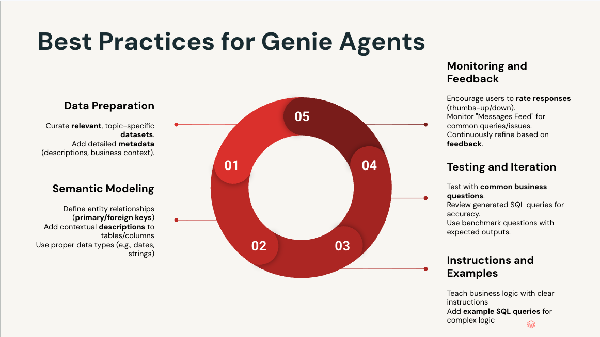

# Genie Agent Scanner

A portable Agent Skill (`genie-space-scan-optimize`) that audits one Databricks
Genie agent, scores it against a 12-check rubric, and guides approval-gated
fixes through the Genie REST API. It ports the *scan → scored report → guided optimize* flow of
[Genie Workbench](https://github.com/databricks-solutions/databricks-genie-workbench)
without installing the Workbench app, and runs in Genie Code (primary), Claude
Code, and Cursor.

> **A stopgap, not a replacement for Genie Workbench.** Use it to keep moving
> while the full Workbench app is being installed. It covers only part of what
> Workbench does.

**Status:** WIP. Unsupported community port, published for early feedback.

## Why use it
- **Light.** No app, backend, or Lakebase. Just a folder of readable Markdown and
  Python, with no network egress beyond the workspace's own Genie / Unity
  Catalog APIs.
- **Deterministic.** The score comes from a pure, no-LLM scorer (no model calls,
  no SQL warehouse), so results are reproducible and match Workbench's rubric.
- **Safe.** Fixes are previewed as a diff and nothing is written until you
  approve it.

## Genie best practices (what the scan checks)



A good Genie agent is built in five stages. The scan scores the first four and
tells you which stage to fix first:

| Stage | What good looks like | Scan checks |
|---|---|---|
| **1. Data preparation** | A small set of curated, topic-specific tables (≤ 12) with business descriptions on each table. | 1 Data sources, 2 Table descriptions, 6 Data source count |
| **2. Semantic modeling** | Joins defined between tables (primary / foreign keys), descriptions on the columns users ask about, correct data types, entity matching on categorical columns. | 3 Column descriptions, 5 Join specs, 9 Entity / format matching |
| **3. Instructions & examples** | Short, clear text instructions for business logic; reusable SQL snippets (measures, filters); 10-15 example SQL queries for complex questions. | 4 Text instructions, 7 Example SQL, 8 SQL snippets |
| **4. Testing & iteration** | 10+ benchmark questions with expected SQL, an optimization run, and ≥ 85% benchmark accuracy. | 10 Benchmarks, 11 Optimization run, 12 Accuracy |
| **5. Monitoring & feedback** | Users rate answers (thumbs up / down); authors review the Monitoring tab for recurring questions and failures and feed them back into stages 1-4. | Not scored (ongoing) |

The score is the number of passed checks (0-12), with a maturity tier:
**Not Ready** (any of checks 1-10 fail), **Ready to Optimize** (1-10 pass), or
**Trusted** (all 12 pass). Full rubric: [`references/scan-checks.md`](./references/scan-checks.md);
fix order and anti-patterns: [`references/best-practices.md`](./references/best-practices.md).

## Install
It is a standard Agent Skill (a folder with `SKILL.md` at its root), so
installing means copying the folder. Name the installed folder
`genie-space-scan-optimize/` to match the skill name.

```
git clone https://github.com/databricks-solutions/technical-services-solutions.git
cd technical-services-solutions/genie/genie-agent-scanner
```

| Assistant | Copy the folder to |
|---|---|
| **Genie Code** | `/Workspace/Users/<your-email>/.assistant/skills/genie-space-scan-optimize/` (personal) or `/Workspace/.assistant/skills/...` (workspace-wide, admin). Or use Genie Code **Settings → Open skills folder**. Start a **new** chat afterwards. |
| **Claude Code** | `~/.claude/skills/genie-space-scan-optimize/` (all projects) or `.claude/skills/...` (this project). Picked up live. |
| **Cursor** | Cursor's skills directory. |

For **local** runs (Claude Code, Cursor, terminal), install the scorer's
dependencies once: `pip install -r scripts/requirements.txt`. Inside Genie Code
no local Python is needed.

> The skill is not yet published to the `databricks aitools install` catalog,
> so install it manually for now.

## Usage
Name the agent and say what you want. No agent ID or long prompt is needed:
- "Scan the Meridian Customer Operations agent."
- "Scan this Genie agent and tell me what to fix first."
- "Optimize this agent." (previews fixes, writes only after you approve)

Or run the scorer directly from a terminal with a Databricks profile:
```
python scripts/scan.py --space-id <AGENT_ID> --json-out scan.json --md-out scan.md
```

## License & attribution
A derivative work of the public Databricks Genie Workbench accelerator
(`databricks-solutions/databricks-genie-workbench`), distributed under the
**Databricks License** (see the repository-root [`LICENSE.md`](../../LICENSE.md)).
The scoring rubric and lever mapping in `scripts/` are adapted from its
optimizer package; see [`NOTICE.md`](./NOTICE.md). This
is an unsupported community port, **not** an official Databricks product,
certification, or supported feature.
