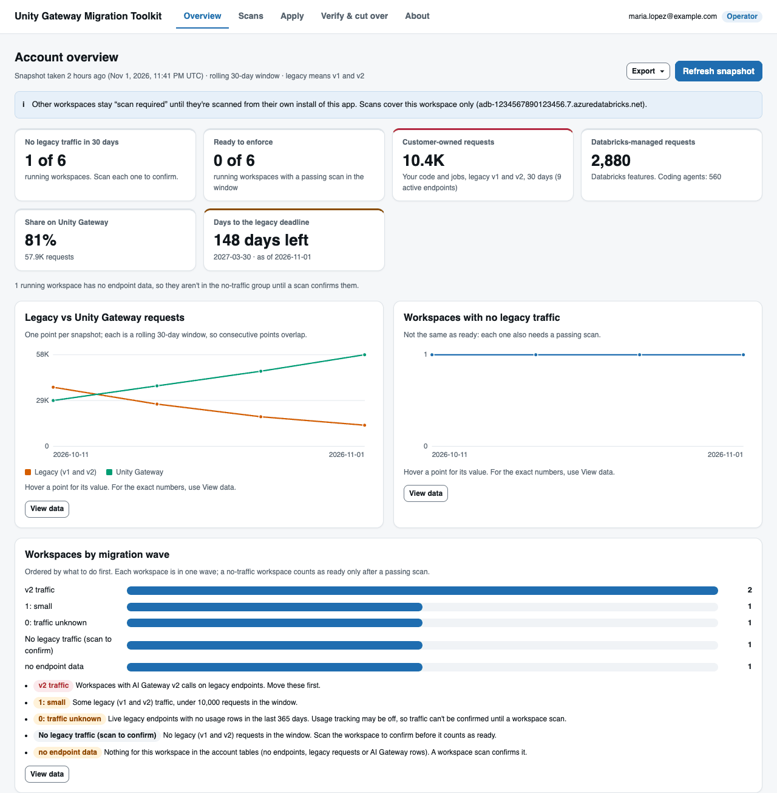

# Unity Gateway Migration Toolkit (prototype, v0.10.0)

Moves legacy model serving endpoints (v1, and v2 workspace-bound endpoints) to Unity Gateway. Planning and scans only read. Writes happen only when you start them: apply, rollback, usage tracking, pause and resume, test calls, and snapshots.

> Prototype from Databricks Shared Technical Services, provided as is. Review every result before you act on it.

**Deadline:** every legacy endpoint stops accepting requests on **March 30, 2027** (confirmed as of November 1, 2026).

## Quick start (about 5 minutes, inside the workspace)

1. Download `unity-gateway-migration-toolkit-0.10.0.zip` and unzip it. In the workspace, import `INSTALL_unity_gateway_migration_toolkit_0_10_0.py` from the zip's top folder.
2. Open the notebook. Set **Install: Results catalog** and **Install: SQL warehouse**. Leave the other widgets.
3. Click **Run all**. The last cell prints the app link.
4. Open **Compute > Apps > ug-migration-toolkit**.
5. Work through the tabs in order: **Overview** (refresh the snapshot), **Scans** (scan this workspace), **Apply** (dry run, then execute), **Verify & cut over** (traffic, tracking, pause, test call, Enforce checklist).

Run the installer as a workspace admin with system table access, because the jobs run as you. If the installer says the target schema `ai_gateway.migrated` is missing, create it first. The installer prints the SQL.

*The account overview after a snapshot: counts, days to the deadline, the trend, and the migration waves.*

## What it does

- Inventories every legacy endpoint, v1 and v2, with its traffic and callers, for one workspace or the whole account.
- Finds the code that calls legacy endpoints and proposes each line change. It never edits your code.
- Creates Unity Gateway services for external model and Provisioned Throughput endpoints when you ask, with rollback.
- Runs the verify and cut-over steps and says whether a workspace is ready to enforce.

Job tags: the toolkit's jobs carry `tool = ug-migration-toolkit`, `Project = unity-gateway-migration-toolkit`, `app` and `role`. They are labels only.

## Documentation

- [USER_GUIDE.md](USER_GUIDE.md): the full journey, from install to uninstall, then reference, troubleshooting, limitations and FAQ.
- [HOW_TO_READ.md](HOW_TO_READ.md): what each output file contains.

## Command line and bundle

The planning and apply code also runs as Python scripts (`ug_migration_planner.py`, `ug_migration_account.py`, `ug_migration_apply.py`) and as a Declarative Automation Bundle (`databricks.yml`). See [section 7](USER_GUIDE.md#7-command-line-and-bundle). The verify and cut-over steps run from the app only.
