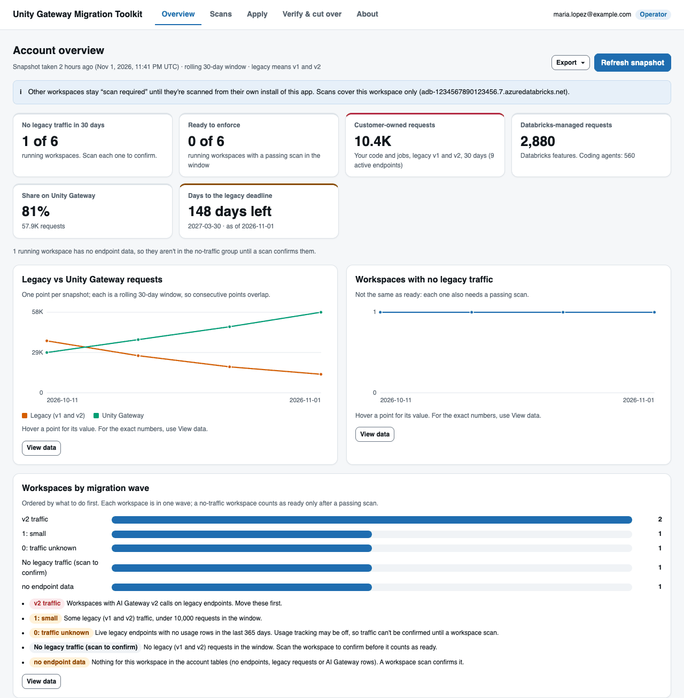

# Unity Gateway Migration Toolkit (prototype, v0.11.0)

Moves legacy model serving endpoints (v1, and v2 workspace-bound endpoints) to Unity Gateway. Planning and scans only read. Writes happen only when you start them: apply, rollback, usage tracking, pause and resume, test calls, and snapshots.

> Prototype from Databricks Shared Technical Services, provided as is. Review every result before you act on it.

**Deadline:** every legacy endpoint stops accepting requests on **March 30, 2027** (confirmed as of November 1, 2026).

## Quick start (about 5 minutes, inside the workspace)

1. Download `unity-gateway-migration-toolkit.zip` from the [release page](https://github.com/databricks-solutions/technical-services-solutions/releases/tag/unity-gateway-migration-toolkit-latest) and unzip it. In the workspace, import `INSTALL_unity_gateway_migration_toolkit_0_11_0.py` from the zip's top folder.
2. Open the notebook. Set **1. Catalog** and **2. SQL warehouse**. Leave **3. Schema for new model services** blank (the installer creates `<catalog>.ug_migrated`) and **4. Setup** at `quick`.
3. Click **Run all**. It checks everything first and prints one checklist; if something needs fixing, nothing is changed. The last cell prints the app link.
4. In the app, work through the tabs in order: **Overview**, **Scans**, **Apply** (dry run, then execute), **Verify & cut over**.

**[INSTALL.md](INSTALL.md)** has what you need, what the install creates, the checklist, updates, custom setup and uninstall, on one page.

Run the installer as a workspace admin with access to the system tables. The toolkit creates two schemas in the catalog you pick: `ug_migration` for its results, and `ug_migrated` for the model services Apply creates (the service names end up in your callers' code, so you can name an existing schema instead). By default the jobs run as you; for anything beyond a trial, use custom setup to run them as a service principal ([Who the jobs run as](USER_GUIDE.md#1-install)). The first snapshot reads account-wide system tables, so it covers every workspace in the account. Many workspaces? One install can also scan the others ([Central mode](USER_GUIDE.md#central-mode-optional-one-install-for-many-workspaces), optional).

*The account overview after a snapshot: counts, legacy tokens, v2 calls already failing, days to the deadline, the trend, and the migration waves.*

## What it does

- Inventories every legacy endpoint, v1 and v2, with its traffic (requests, and tokens for sizing) and callers, for one workspace or the whole account.
- Finds the code that calls legacy endpoints and proposes each line change. It never edits your code.
- Creates Unity Gateway services for external model and Provisioned Throughput endpoints when you ask, with rollback.
- Runs the verify and cut-over steps and says whether a workspace is ready to enforce.

Job tags: the toolkit's jobs carry `tool = ug-migration-toolkit`, `Project = unity-gateway-migration-toolkit`, `app` and `role`. They are labels only.

## Documentation

- [INSTALL.md](INSTALL.md): install, update and uninstall, on one page.
- [USER_GUIDE.md](USER_GUIDE.md): the full journey, from install to uninstall, then reference, troubleshooting, limitations and FAQ.
- [HOW_TO_READ.md](HOW_TO_READ.md): what each output file contains.

## Command line and bundle

The planning and apply code also runs as Python scripts (`ug_migration_planner.py`, `ug_migration_account.py`, `ug_migration_apply.py`) and as a Declarative Automation Bundle (`databricks.yml`). See [section 7](USER_GUIDE.md#7-command-line-and-bundle). The verify and cut-over steps run from the app only.
