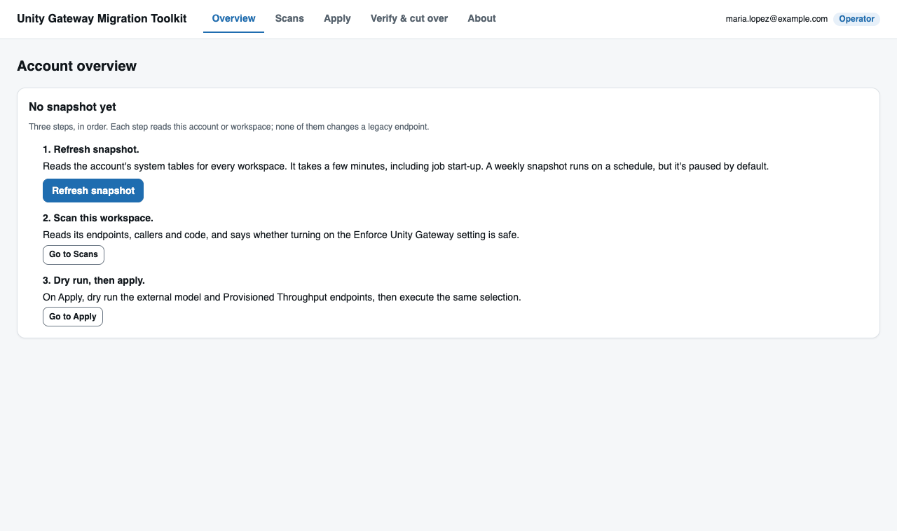
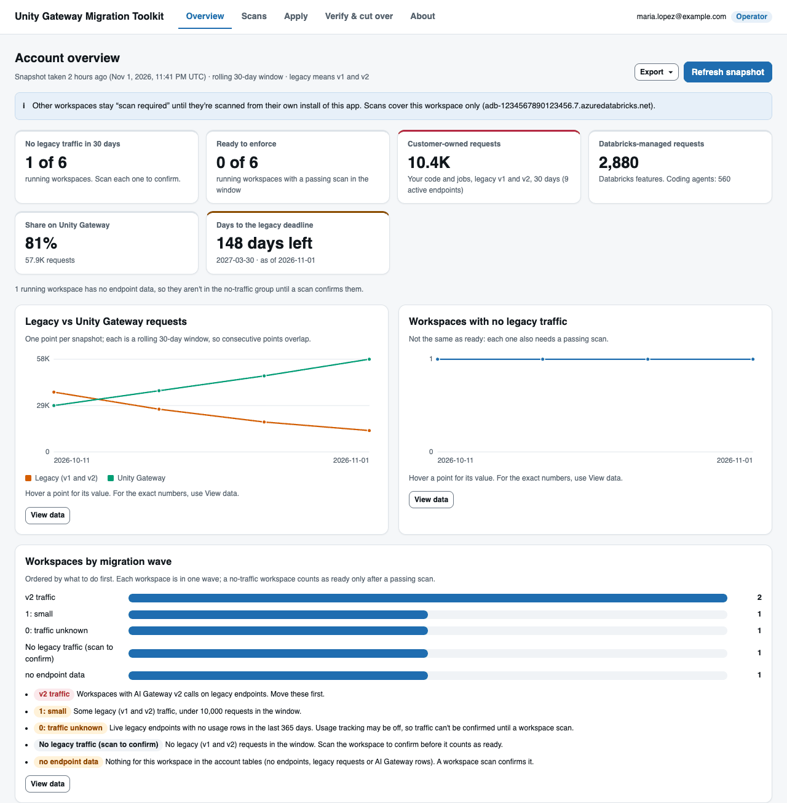
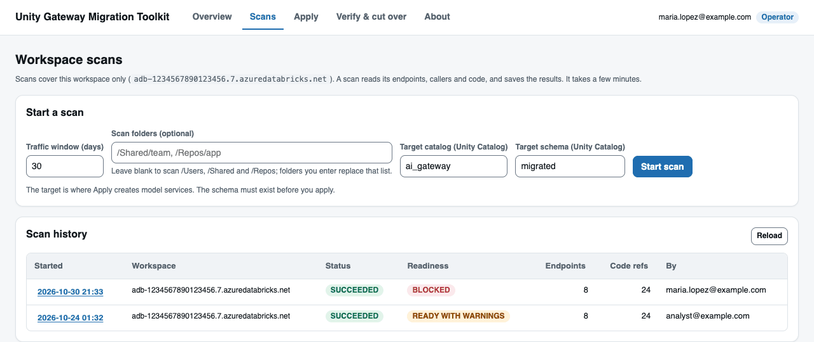
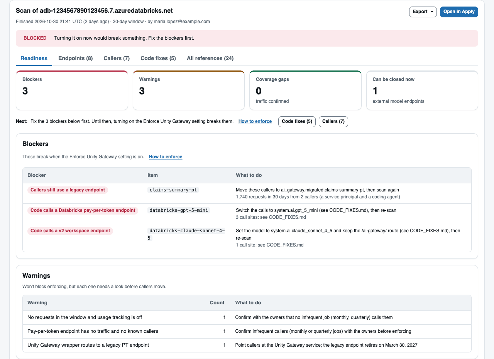
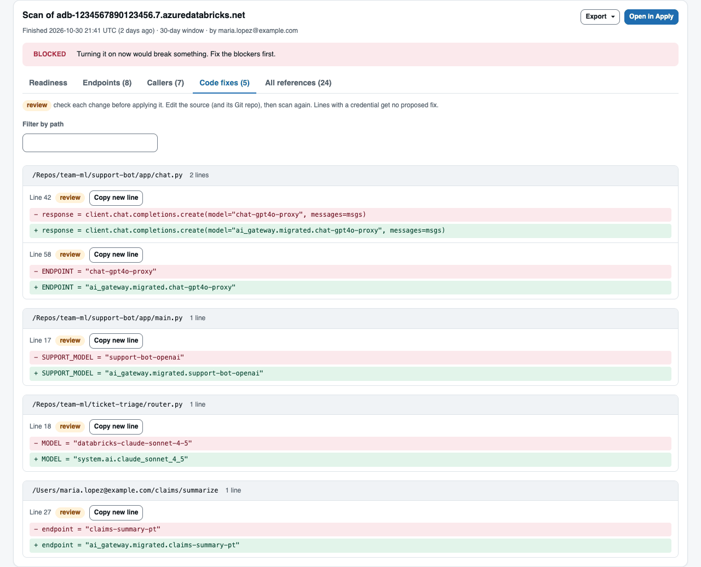
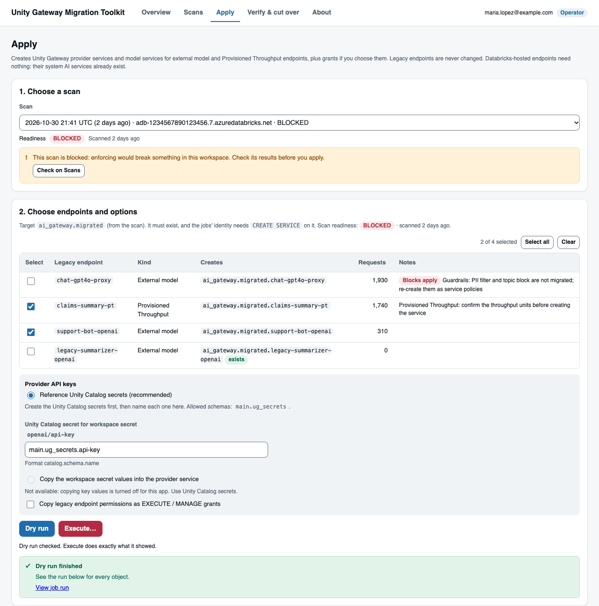
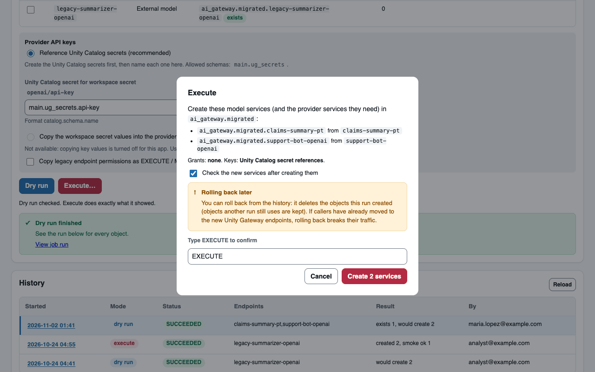
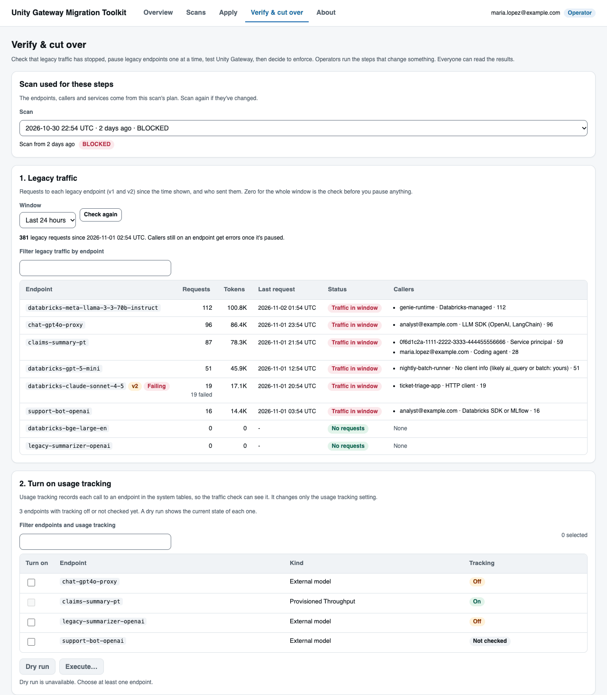
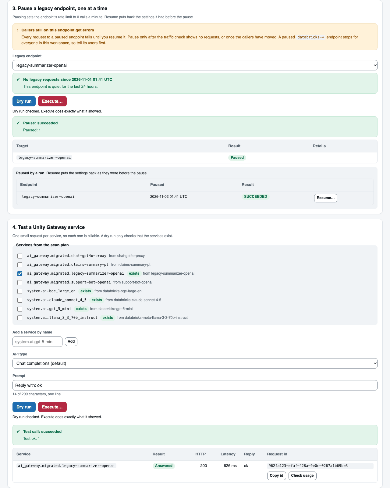
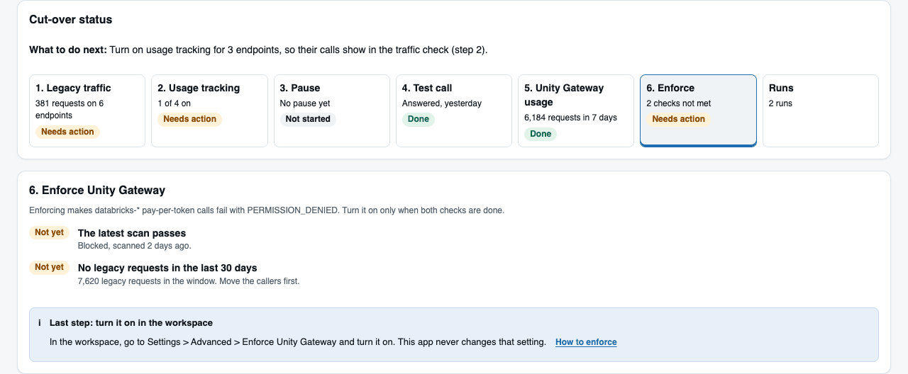

# Unity Gateway Migration Toolkit: User Guide

Version 0.10.3 (prototype)

> Prototype from Databricks Shared Technical Services, provided as is. Planning and scans only read. Writes happen only when you start them. Review every result before you act on it.

## Contents

- [Start here](#start-here)
- [1. Install](#1-install)
  - [Before you start](#before-you-start)
  - [Install the toolkit](#install-the-toolkit)
  - [Update and upgrade](#update-and-upgrade)
  - [Upgrade notes: 0.10.2 to 0.10.3](#upgrade-notes-0102-to-0103)
  - [Upgrade notes: 0.10.1 to 0.10.2](#upgrade-notes-0101-to-0102)
  - [Upgrade notes: 0.10.0 to 0.10.1](#upgrade-notes-0100-to-0101)
  - [Upgrade notes: 0.9.0 to 0.10.0](#upgrade-notes-090-to-0100)
  - [Other install methods](#other-install-methods)
- [2. First run](#2-first-run)
- [3. Migrate](#3-migrate)
  - [Pick your wave](#pick-your-wave)
  - [Scan the workspace](#scan-the-workspace)
  - [Read readiness](#read-readiness)
  - [Fix the callers](#fix-the-callers)
  - [Create services for external and PT endpoints](#create-services-for-external-and-pt-endpoints)
- [4. Verify and cut over](#4-verify-and-cut-over)
  - [Step 1: Check legacy traffic](#step-1-check-legacy-traffic)
  - [Step 2: Turn on usage tracking](#step-2-turn-on-usage-tracking)
  - [Step 3: Pause one legacy endpoint](#step-3-pause-one-legacy-endpoint)
  - [Step 4: Test call](#step-4-test-call)
  - [Step 5: Check Unity Gateway traffic](#step-5-check-unity-gateway-traffic)
- [5. Enforce](#5-enforce)
- [6. Uninstall and cleanup](#6-uninstall-and-cleanup)
- [7. Command line and bundle](#7-command-line-and-bundle)
- [8. Reference](#8-reference)
  - [Deadline override](#deadline-override)
  - [Installer widgets](#installer-widgets)
  - [Blockers and warnings](#blockers-and-warnings)
  - [Caller types](#caller-types)
  - [Typed confirmation words](#typed-confirmation-words)
  - [Result actions](#result-actions)
  - [Run statuses](#run-statuses)
  - [Report files](#report-files)
  - [Workspace-bound v2 endpoints](#workspace-bound-v2-endpoints)
  - [Progress and exports](#progress-and-exports)
  - [Runbook mapping](#runbook-mapping)
  - [Safety and data handling](#safety-and-data-handling)
- [9. Troubleshooting](#9-troubleshooting)
- [10. Limitations](#10-limitations)
- [11. FAQ](#11-faq)

---

## Start here

The toolkit moves your workspace off legacy model serving endpoints. It finds every legacy endpoint, its traffic, its callers and the code that calls it, and proposes each code change. It never edits code. It creates Unity Gateway services for external model and Provisioned Throughput (PT) endpoints, checks traffic, pauses and resumes endpoints, sends test calls, and tells you when a workspace can turn on Enforce Unity Gateway.

It runs inside your workspace: an installer notebook, a Databricks app and three Lakeflow jobs. **Who it's for:** customer workspace and account admins, and Databricks field engineers, who must finish before the deadline.

### The deadline

**Every legacy endpoint stops accepting requests on March 30, 2027.** That covers v1 serving endpoints and v2 workspace-bound endpoints: pay-per-token (`databricks-*`), embedding, PT and external model endpoints. The date is confirmed as of November 1, 2026.

- Custom model and feature serving endpoints aren't affected. Government cloud workspaces can have different dates: ask your account team.
- The date sets the countdown and wording in the app and reports. It doesn't change any readiness result.
- Overriding the date changes only the toolkit's countdown and job parameters. It doesn't change when the platform stops the endpoints.

To change the date the toolkit counts down to, see [Deadline override](#deadline-override).

### The five steps

1. **Install** (about 5 minutes). See [Install the toolkit](#install-the-toolkit).
2. **Scan and read readiness.** See [Scan the workspace](#scan-the-workspace) and [Read readiness](#read-readiness).
3. **Move the callers and create services.** Owners apply code fixes. You create services for external and PT endpoints, dry run first. See [Fix the callers](#fix-the-callers).
4. **Verify and cut over.** Check traffic, pause one endpoint at a time, and send test calls. See [section 4](#4-verify-and-cut-over).
5. **Enforce, then clean up.** Enforce when the checklist passes. Uninstall when you no longer need the toolkit. See [section 5](#5-enforce) and [section 6](#6-uninstall-and-cleanup).

### What it changes

- Planning and scans only read. Scans store results, including matched code lines, in the results schema.
- Apply creates services and grants, only when you execute. Rollback deletes what one apply run created.
- Cut-over steps change a legacy endpoint only when you run them: tracking, pause (rate limit 0), resume, and billable test calls.
- It never edits code, deletes a legacy endpoint or turns on Enforce. Every execute needs a dry run of the same selection, from the last 24 hours, and a typed word. Each dry run allows one execute: after an execute, run a new dry run. The jobs check this too, so starting a job directly doesn't skip the dry run. Run times are written and compared in UTC, whatever the job's or warehouse's time zone.
- Run details and exports are visible to the person who started the run, operators and workspace admins. Run lists and the Overview are open to every app user.

### Terms used here

A **legacy endpoint** is a v1 serving endpoint (`/serving-endpoints/<name>/invocations`) or a workspace-bound v2 AI Gateway endpoint ([details](#workspace-bound-v2-endpoints)). A **model service** is the Unity Gateway service callers use, named `catalog.schema.name`. A **provider service** holds an external provider's credentials.

---

## 1. Install

### Before you start

| Task | What you need |
|---|---|
| Traffic and account view | `SELECT` on `system.serving.endpoint_usage`, `system.serving.served_entities`, `system.ai_gateway.usage` and `system.access.workspaces_latest`. By default only account admins can query them |
| Scan | Read access to the endpoints and to the folders, jobs, queries, dashboards, apps and pipelines you scan |
| Apply | `USE CATALOG`, `USE SCHEMA` and `CREATE SERVICE` on the target schema, `MANAGE` or ownership to grant, and read access to each secret in the map |
| Cut over | Operators start runs. The job identity needs `EXECUTE` on each service it tests, plus `USE CATALOG` and `USE SCHEMA`. Pause and tracking changes need permission to update the endpoint |

**Identity.** For one workspace, a workspace admin is enough. For an account, use one service principal with account admin (for system tables), assigned to each workspace you deep-scan, with `DATABRICKS_CLIENT_ID` and `DATABRICKS_CLIENT_SECRET` set. Scan only workspaces you are authorized to review.

### Install the toolkit

The installer notebook is the only file you import. It creates everything inside the workspace in about 5 minutes.

1. Download `unity-gateway-migration-toolkit.zip` from the [release page](https://github.com/databricks-solutions/technical-services-solutions/releases/tag/unity-gateway-migration-toolkit-latest) and unzip it. In the workspace, go to your home folder, choose **Import**, and import `INSTALL_unity_gateway_migration_toolkit_0_10_3.py` from the zip's top folder.
2. Open the notebook. Set **Install: Results catalog** (a catalog where you can create a schema) and **Install: SQL warehouse**. Leave the other widgets at their defaults ([Installer widgets](#installer-widgets)). If the widget panel shows widgets from an older installer, remove them once, then run again.
3. Click **Run all**.

It creates the toolkit files (default `/Workspace/Users/<you>/ug-migration-toolkit`), the results schema, three Lakeflow jobs (account snapshot, workspace scan and apply) and the **Unity Gateway Migration Toolkit** app.

**Checks first.** The installer checks privileges, the warehouse, the four system tables it reads, the install folder, other installs, bundle-deployed apps and jobs, the deadline and active runs. A failed check stops the run with the fix and "Nothing was changed".

**At the end** it prints the app link (**Compute > Apps > ug-migration-toolkit**), the job links and whether the first snapshot started. It also reports the target schema, that the weekly snapshot is paused, and that secret mapping is off.

**Who the jobs run as.** You, unless you set **Advanced: Run jobs as service principal** to a service principal's application ID. Then all three jobs run as that service principal. You need its **Service principal: User** role (Settings > Identity and access > Service principals > the service principal > Permissions; creating the service principal only gives you Manager, and workspace admin isn't enough: the installer checks this before it changes anything). It needs the system table, results schema and target schema access in [Before you start](#before-you-start). The installer gives it CAN MANAGE on the install folder. Only people in **Install: Operators** can start jobs from the app.

**The first snapshot is account-wide.** It reads account-wide system tables, so it covers every workspace in the account, not only this one. The installer says so before it starts the snapshot.

### Central mode (optional): one install for many workspaces

By default each workspace has its own install. In central mode, one install (the hub) also works on other workspaces in the account: it scans them (inventory, code, readiness, legacy traffic) and makes changes there (apply, rollback, pause, resume, usage tracking, test calls, guardrail checks). Pick the workspace in the header; Apply uses that workspace's scans and creates the services there, and every change runs there, signed in as the service principal. Every confirm dialog names the workspace, and the run lists show it. A rollback or a resume always acts on the workspace of the run it undoes. One run at a time across all workspaces.

To turn it on, run the installer with:

1. **Advanced: Run jobs as service principal** set to a service principal's application ID (you need its Service principal: User role, see [Who the jobs run as](#1-install)).
2. **Advanced: Central mode: workspaces to manage** set to the workspace IDs to scan (comma-separated).
3. **Advanced: Central mode: service principal OAuth secret** set to the `scope/key` of a secret that holds that service principal's OAuth client secret, in a scope the service principal can read.

Then add the service principal to each listed workspace as a workspace admin (an account admin can do it from the account console, or each workspace's admin by application ID). In each workspace it needs what the jobs need there: workspace admin (scan, pause, resume, tracking), `USE CATALOG`, `USE SCHEMA` and `CREATE SERVICE` on the target schema, `EXECUTE` on the services it tests, and READ on the secret scopes when it creates Unity Catalog secrets from workspace secrets (it reads that workspace's scopes).

Workspaces on the same metastore share Unity Catalog names: give each workspace its own target schema (for example `ai_gateway.migrated_<workspace>`) to avoid collisions.

- The scan job signs in to each workspace as that service principal. The app never sees the secret.
- The workspace URL comes from `system.access.workspaces_latest`, never from the app, and the job checks it answers as the expected workspace.
- A **Workspace** picker appears in the app header. Scans, Apply and Verify & cut over follow it.
- Scans of another workspace don't include Unity Catalog function and view definitions (they're per metastore), so their status can't go above `READY_WITH_WARNINGS`. Traffic comes from the account-wide system tables; a workspace in another region than the hub may show none.
- **Security:** this service principal can read every listed workspace. Keep the list short, give it only the access the scan needs, and rotate its secret like any credential.

### Update and upgrade

Import the newer installer and run it with the same widgets. Results history is kept, and blank locations reuse the existing ones. The app keeps its settings, and the weekly snapshot keeps its paused or unpaused state. A downgrade is refused unless **Advanced: Allow downgrade** is `yes`.

- **From 0.8.0** (app `unity-gateway-migration`): the default name is now `ug-migration-toolkit`. To update in place, set **Install: App name** to `unity-gateway-migration`. To move to the new name, uninstall first (an app can't be renamed), then install.
- **From 0.7.0** (app `ug-migration`): the same two choices apply.
- **Bundle:** the app is now `ug-migration-bundle`. Run `databricks bundle plan` first. It creates a new app, so delete the old one by hand.
- **Since 0.7.0:** grants are off by default, Execute needs a matching dry run, and scans older than 14 days and endpoints with legacy guardrails need confirmation or an acknowledgement. Account wave 0 is now `0: no legacy traffic`.

#### Upgrade notes: 0.10.2 to 0.10.3

Scan again. Tables and jobs don't change.

- **Short endpoint names.** An endpoint with a short or common name (`llm`, `chat`, `test`, or under 6 characters) is now found inside a `serving_endpoints.query(...)` or MLflow `predict(...)` call. Before, such a call was missed, and an endpoint with no traffic could be listed as one to close.
- **Rollback has a dry run in the app.** **Roll back: dry run** lists what would be deleted; the rollback itself follows it. A rollback started without a matching rollback dry run is refused by the app and by the job.
- **Volumes and DBFS.** Readiness now says that files in Unity Catalog volumes and DBFS aren't searched (a note, `volumes_dbfs`).

#### Upgrade notes: 0.10.1 to 0.10.2

Scan again. Tables and jobs don't change.

- **Agent endpoints** aren't retired, so they are now out of scope (no change for their callers) with an `agent_endpoint` warning about the LLM calls inside them, instead of an `agent` blocker. `dormant_agent_endpoint` is folded into it. Knowledge Assistant and Supervisor Agent endpoints get `agent_bricks_endpoint`, which points to Genie Agents.
- **AI Search** advice says what's known: no date for Unity Gateway embedding services, an index has to be recreated to change its embedding endpoint, and an index on a `databricks-*` embedding stops at the deadline even with Enforce off.
- **Agent traffic.** Agent endpoints can't turn on usage tracking, so their findings say traffic unknown instead of "no requests".
- **Agent model code.** Calls inside `ResponsesAgent`, `ChatAgent` and `ChatModel` classes (the classes `agents.deploy` serves) now get the same model-code note as `PythonModel` classes: they run inside the agent's endpoint, so re-log it with explicit credentials.
- **The toolkit's own app** (source folder and its service principal's deployment copies) is no longer scanned. An app counts as the toolkit's only when its description starts with "Unity Gateway Migration Toolkit" *and* its source is bound to it: the install marker next to `files/app` names the app (installer), or the source is the toolkit's bundle root (`.bundle/unity-gateway-migration-toolkit/...` with its `databricks.yml`). Skipping it is a note, not a coverage gap, and the note names each skipped app and folder. A folder that holds toolkit files but isn't used by such an app is still skipped, as a coverage gap that names the folder: check it by hand.
- **Apply** now creates a model service for an external model endpoint that forwards to a `databricks-*` endpoint: a pay-per-token destination on the same model, keeping the rate limits and inference table. No provider service is needed. It does so only when the `system.ai` UC model is confirmed in the `system.ai` model list; otherwise the plan is manual (`unconfirmed_model`).
- **Agents' inner calls block.** `custom_endpoint_inner_call` (requests from a `System Service Principal`) is now a blocker when the endpoint is one Enforce stops (`databricks-*`, or an external model that forwards to one). An agent's model code is often a logged model the code scan can't read, so its traffic is what shows the break.

#### Upgrade notes: 0.10.0 to 0.10.1

Scan again: 0.10.1 finds more calls and fewer false ones. Tables and jobs don't change.

- **Calls with a variable endpoint name.** `get_open_ai_client()`, `serving_endpoints.query(name=<variable>)`, the MLflow deployments client, `ChatDatabricks(endpoint=<variable>)` and `endpoints:/{...}` URIs are now `unresolved_endpoint_call` blockers. These clients are bound to `/serving-endpoints`, so changing only the name gives a 404.
- **Calls to custom model endpoints** are now `custom_endpoint_call` (no change) instead of a move, and are no longer warnings. A `serving_endpoints.query` call with a variable name and tabular input (`dataframe_records`, `dataframe_split`, `instances` or `inputs`) is a `tabular_endpoint_call` warning: usually a custom model, but the scan can't name it.
- **External models that forward to a `databricks-*` endpoint** (provider `databricks-model-serving`) are now an `external_model_on_ppt` blocker: Enforce stops the endpoint they forward to.
- **Custom agents.** Calls inside MLflow model code (a `PythonModel` class) name the custom endpoint that serves the model and say how to re-log it. `System Service Principal` callers of a pay-per-token endpoint get a `custom_endpoint_inner_call` warning. Usage tracking can now be turned on for custom model endpoints (never paused), only for endpoints the scan lists as trackable.
- **Enforce status.** READINESS.md and `readiness.json` (`enforce`) show whether Enforce Unity Gateway is on.
- **Fewer warnings.** Pay-per-token endpoints with no traffic and no known callers are one `confirm_infrequent_callers` warning instead of one each.

#### Upgrade notes: 0.9.0 to 0.10.0

- **Deadline and waves.** One date now applies to every legacy endpoint, and the separate v2 date is gone. `v2 first` is now `v2 traffic`, with no urgency of its own.
- **Caller split.** Snapshot tables gain `customer_requests`, `platform_requests` and `coding_agent_requests`. Blocking counts use customer-owned requests only.
- **Findings and scans.** New blocker and warning types are listed in [Blockers and warnings](#blockers-and-warnings). Scan again, because 0.9.0 scans don't have workspace-bound v2 endpoints.
- **Verify and cut over** is a new tab. Rollback in Apply refuses a pause run: use **Resume**.
- **Jobs and tables.** The apply job gets `operation`, `api_type`, `prompt` and `services`. The snapshot and scan jobs get `deadline`. `ug_migration_applies` gains `operation`, `services` and `api_type`; a blank `operation` means apply.

### Other install methods

- **Local (laptop or CI).** Run `pip install "databricks-sdk>=0.158.0" requests`, then `python ug_migration_planner.py --help`. You need Python 3.10 or later, a CLI profile and a SQL warehouse.
- **Notebooks.** Upload `ug_migration_*.py` and `notebook/` to a workspace folder, keeping the layout.
- **Bundle.** See [Bundle](#bundle).

Use one install method per workspace. For a second install side by side, set **Advanced: Allow a second install**. A second install shows a **Second install: <app name>** badge in the app header, so it's hard to confuse with the main one.

---

## 2. First run



*The Overview before the first snapshot finishes. It lists the three steps in order.*

1. **Wait for the first snapshot.** The Overview fills in within a few minutes. If it didn't start, click **Refresh snapshot** (operators only).
2. **Create the target schema if the installer asked.** Apply never creates schemas. The installer prints the exact statements for your identity, which look like this:

   ```sql
   CREATE SCHEMA IF NOT EXISTS `ai_gateway`.`migrated`;
   GRANT USE CATALOG ON CATALOG `ai_gateway` TO `<you>`;
   GRANT USE SCHEMA, CREATE SERVICE ON SCHEMA `ai_gateway`.`migrated` TO `<you>`;
   ```

3. **Open Scans and click Start scan.** Continue with [Migrate](#3-migrate).

The Overview shows every workspace with legacy endpoints or Unity Gateway traffic, with its wave and readiness. It reads only complete snapshots, so a failed run never shows as zero traffic.

**Weekly snapshot.** The snapshot runs Mondays at 06:00 UTC and is **paused by default**. To run it weekly, open **Jobs > [your app name] Unity Gateway migration snapshot** and unpause its schedule. A bundle redeploy pauses it again.

**Give others access.** Users read results as themselves, so they need `USE CATALOG` on the results catalog, `USE SCHEMA` and `SELECT` on the results schema, and **CAN USE** on the app and the warehouse. Keep the results schema to the migration team, because scans store matched code lines.

---

## 3. Migrate

Move callers in this order: coding agents and simple SDK callers first, then apps, then `ai_query` jobs, then AI Search and agents last.

### Pick your wave

On a multi-workspace account, start on the Overview. Each workspace gets one wave, and the first matching rule wins.



*The account overview: headline counts, legacy tokens, v2 calls already failing, days to the deadline, the legacy and Unity Gateway trend, and waves.*

| Wave | Rule | Next step |
|---|---|---|
| `not running` | Status isn't RUNNING. Not counted | None |
| `no endpoint data` | Running, with no endpoint, usage or AI Gateway rows | Scan the workspace |
| `2: high volume` | 10,000 or more legacy requests (v1 and v2) | Plan per workload with owners |
| `v2 traffic` | Any v2 requests below the high-volume line | Move these callers with the rest |
| `1: small` | 1 to 9,999 v1 requests, and no v2 requests | Migrate with owners |
| `no legacy endpoints (custom ML only)` | Only custom ML or feature serving endpoints | Scan it: notebooks can still call legacy endpoints |
| `1: cleanup` | No v1 traffic, but external, PT or other legacy endpoints exist | Confirm with owners, then retire or apply |
| `0: traffic unknown` | Live legacy endpoints with no usage rows in 365 days | Scan the workspace |
| `0: no legacy traffic` | No v1 or v2 requests in the window, and no unknown endpoints | Not ready by itself. Scan the workspace |

A wave-0 workspace shows "Ready to enforce (scan passed)" only with a passing scan (READY or READY_WITH_WARNINGS) inside the traffic window.

### Scan the workspace



*Start a scan: set the traffic window and the target, then click Start scan.*

On **Scans**, fill in **Start a scan**:

- **Traffic window (days)**, default 30.
- **Scan folders (optional)**, which replace `/Users`, `/Shared` and `/Repos`. A narrower list makes the scan incomplete.
- **Advanced: target schema for the proposed names** (optional): the catalog and schema the scan uses to name the proposed services. You choose the real target in Apply, and can change it there without a new scan.

Click **Start scan**. The app scans only its own workspace, in about 3 minutes for 3,600 notebooks and files. Code outside the workspace needs the CLI `--local-path` option. Without it, the status can't go above READY_WITH_WARNINGS.

### Read readiness



*The Readiness tab: the status, each blocker with its next step, and the warnings.*

| Status | Meaning | Next step |
|---|---|---|
| `READY` | No blockers, a complete scan, and no legacy requests in the window (30 days by default) | Confirm unused endpoints with owners, then complete the Enforce checklist |
| `READY_WITH_WARNINGS` | No blockers, but warnings remain | Review each warning, fix or accept it, then scan again |
| `BLOCKED` | Enforcing now would break the listed calls | Fix each blocker, then scan again |
| `INCOMPLETE` | Nothing blocking was found, but part of the scan didn't run or traffic couldn't be confirmed | Fix the gap under "Incomplete scan", then scan again |

- **Blockers** name the endpoint or file and the action ([Blockers and warnings](#blockers-and-warnings)).
- **Warnings** break only if the code still runs. The most common is `legacy_traffic_kept_after_enforce`: an external or PT endpoint that keeps working after Enforce but retires on the deadline.
- **Incomplete scan** usually means no `SELECT` on the system tables, or a stopped warehouse.
- **Can be stopped now.** External model endpoints with no traffic, code references or dependents are listed with a command that sets their rate limit to 0 calls a minute. READINESS.md gives the undo. PT endpoints are never listed.

Zero requests in the window isn't proof that nothing calls an endpoint, so confirm with owners.

### Fix the callers



*The Code fixes tab: old lines in red, proposed lines in green, each marked review.*

**Code fixes** on Scans (or `CODE_FIXES.md`) lists each proposed change by file, with the old line (`-`), the new line (`+`) and a `# note:` caveat. Every change has confidence `review`. Test each one in your source repo, then scan again. Manual edits are listed at the end.

- **Coding agents** (Claude Code, opencode, codex and similar): move each agent to Unity Gateway with `ucode`.
- **Your code, jobs and apps:** the owners fix it. The Callers export on Scans lists who calls each endpoint.
- **Databricks-managed callers** (Genie Agents, Agent Bricks, AI Search): you can't change them. Confirm with your account team how they move.

Caveats that matter:

- `ai_query` on Unity Gateway gets usage tracking only. Rate limits, fallbacks, inference tables and service policies don't apply.
- When you change a URL, move the token from the `all-apis` scope to `ai-gateway`. An `ai-gateway` token on a legacy URL returns 403.
- Changing `/invocations` to `/chat/completions` changes the body to OpenAI format, with the model service as `model`.
- Never move a Responses client to Chat Completions. A change of API type needs application-level testing first.
- Some clients only call `/serving-endpoints`, so changing only the endpoint name gives a 404: `w.serving_endpoints.get_open_ai_client()`, `w.serving_endpoints.query`, the MLflow deployments client, and `ChatDatabricks` without `use_ai_gateway=True`. Change the client, as each finding says.
- Calls to custom model endpoints (your own ML models) need no change. They stay on `/serving-endpoints`, and Enforce doesn't affect them.
- A custom agent that calls an LLM from its model code fails on Unity Gateway with automatic authentication (a misleading `NotFound`). Re-log it with explicit credentials, or move it to a Databricks App. On a custom model endpoint, then turn on its usage tracking. Agent endpoints (`agents.deploy`, Agent Bricks) can't turn it on, so their requests aren't in the usage tables: check the agent's inference table or MLflow traces.
- **Credentials for `/ai-gateway/`:** use service principal OAuth (M2M) first, and a PAT with the `ai-gateway` scope only as a fallback. Keep either one in a secret scope and pass it as a `{{secrets/<scope>/<key>}}` reference (for example in a serving endpoint's `environment_vars`). Never paste a literal secret value.

**Workspace-bound v2 endpoints.** Keep the route and change only the model name, from the flat name to the three-part `system.ai` name in the plan (the `target` in CODE_FIXES.md):

```python
# Before: v2 workspace endpoint. Flat name on the gateway route.
client.responses.create(model="<flat-name>", input="...")

# After: same client, same route, three-part model service name.
client.responses.create(model="system.ai.<model-name>", input="...")
```

The target must support the route's API type (its `supported_api_types`). If it doesn't, the reference is `manual`. Check the change with a [test call](#step-4-test-call) before you move production traffic.

**Tell the owners.** Send each owner this note, with the placeholders filled in:

> Subject: `<endpoint>` is moving to Unity Gateway
>
> Please move your calls to `<catalog.schema.service>` (see CODE_FIXES.md, section `<asset>`). Your identity needs `EXECUTE` on it, plus `USE CATALOG` and `USE SCHEMA` on its catalog and schema. Rate limits, guardrails and inference tables don't carry over, so tell us if you depend on them. Reply when deployed so we can check traffic. The legacy endpoint retires on the [migration deadline](#the-deadline).

### Create services for external and PT endpoints

Apply creates provider services, model services and grants for **external model** and **Provisioned Throughput (PT)** endpoints, next to the legacy endpoints, which keep serving until their callers change. Apply never changes a legacy endpoint or turns on Enforce. Two steps in [Verify & cut over](#4-verify-and-cut-over) do change a legacy endpoint when you run them: turning on usage tracking, and pausing (resume restores the saved settings). `databricks-*` endpoints need nothing, because their `system.ai` services exist.

| Object | Created from | Details |
|---|---|---|
| Provider service | External model endpoints | One per provider and credential. Name `<provider>_<scope>_<key>` |
| Model service | Each external or PT endpoint | Destinations and traffic split (must total 100). Fallback becomes the ordered fallback (at most 5). A new `<prefix>_ug_payload` inference table if the legacy one was on |
| Grants | Endpoint permissions | `CAN_QUERY` becomes `EXECUTE`. `CAN_MANAGE` becomes `EXECUTE` and `MANAGE`. `CAN_VIEW` grants nothing |

- **Existing objects** are reused only if they carry the toolkit's mark and have the planned config. Otherwise they're `manual` and get no grants.
- **Supported providers:** OpenAI, Azure OpenAI (API key) and Anthropic. Others are `manual`. Custom ML models and agents are out of scope.
- **Checks before creating:** traffic totals 100; at most 10 primary and 5 fallback destinations; each rate limit translates (toolkit caps: 20 per model service, 5 group-specific). Secrets are checked without reading their values.
- **Guardrails** aren't carried over. An endpoint with them is blocked until you set service policies and acknowledge it (`--ack-guardrails`, or the app's checkbox). Rate limits on `system.ai` targets are reported, not copied.

#### Before you apply

1. **Target schema.** Choose it in the **Target schema for the new services** panel: it's prefilled from the scan (default `ai_gateway.migrated`), and you can change it without a new scan. The proposed service names follow what you type. Create the schema first: the apply identity needs `USE CATALOG`, `USE SCHEMA` and `CREATE SERVICE` on it. A dry run for one target doesn't unlock an execute for another.
2. **Secrets.** Each new provider service needs its API key. Under **Provider API keys** choose one of:
   - **Reference Unity Catalog secrets (recommended):** name an existing Unity Catalog secret that holds each key, for example `"llm/openai": "secrets/ai_gateway.migrated.openai_key"`. It must be in an allowed secret schema (not necessarily the target schema), and the apply identity must be able to read it.
   - **Create Unity Catalog secrets from the workspace secrets:** for endpoints that keep their key in a workspace secret (`{{secrets/scope/key}}`) and have no Unity Catalog secret yet. Pick a schema from the allowed secret schemas; the app proposes a name per secret (`<schema>.<scope>_<key>`), which you can change. The apply job reads each workspace secret with its own identity and stores the value in a new Unity Catalog secret, which the provider service then references. Values are never shown or logged. The dry run checks each workspace secret can be read (`would_create_secret`); execute creates them (`created_secret`). A secret that already exists under the chosen name is reused as is (`exists`; its value can't be compared, so check it holds the right key). Rollback deletes the secrets that run created, after the services that used them. Needs **Advanced: Allowed secret schemas**, and READ on each secret scope for the job identity.
   - **Copy the workspace secret values into the provider service:** puts the key value itself into the provider service. Needs **Advanced: Allow reading secret values**. Keep it off unless you need it.

   An endpoint with a plaintext key (not a secret) is `manual`: the API hides the value, so store it as a Unity Catalog secret first.
3. **Allowed secret schemas.** The schema of each secret must be in **Advanced: Allowed secret schemas**, or apply stops before any change.
4. **Grants** are off unless you tick **Copy legacy endpoint permissions as EXECUTE / MANAGE grants**. Workspace-local `admins` and `users` are skipped and flagged.

#### Dry run



*Apply after a dry run: the endpoints offered, what each creates, and the secret settings.*

1. Choose a scan. A scan older than 14 days needs ticking **Apply with this older scan anyway**.
2. Check the target. If the schema is missing or you lack `CREATE SERVICE`, the page shows the SQL and disables dry run and execute.
3. Choose endpoints (only external and PT endpoints are offered) and enter provider keys, one row per workspace secret (`scope/key`).
4. Set options. An endpoint with AI Gateway guardrails blocks apply until you tick the acknowledgement. The plan note, the checkbox and the Execute dialog say what callers lose, for example: *This endpoint blocks requests that contain PII today (input PII → BLOCK). The new service won't: those requests will reach the model. Re-create the protection on the service or in your callers before moving them.* Check it afterwards with the [guardrail check](#guardrail-check).
5. Click **Dry run**. It runs as a job and creates nothing.

`would_*` rows say what execute would do. `manual` rows need a person: fix the input, then dry run again.

#### Execute



*The execute dialog: type EXECUTE, then click the button that names what will be created.*

Execute needs a successful dry run of the **same** selection and options, from the last 24 hours. A dry run that ends **Needs attention** (some rows `manual`) doesn't unlock Execute: the page names the endpoints that need a person, and **Deselect** removes them from the selection. Dry run the rest again, and fix the others separately. Click **Execute**, then type `EXECUTE`. **Check the new services after creating them** is on by default. It reads each service back but makes no inference call, so run a [test call](#step-4-test-call) to prove a request works.

The run ends `SUCCEEDED`, or `NEEDS_ATTENTION` if any item needs a look ([Result actions](#result-actions)). Fix the cause and run again. Existing objects are skipped.

**Not carried over.** Each service lists the legacy settings it doesn't get: guardrails, rate limits, inference tables, usage tracking, tags, route optimization, budget and usage policies, endpoint permissions and other AI Gateway settings. Set the ones you need on the service by hand. An endpoint that splits traffic across several served entities with fallback on is `manual`, because the fallback can't be carried over.

#### Roll back

Click **Roll back: dry run**. It lists exactly what rollback would delete, including provider services, and deletes nothing. On its results, click **Delete these objects** and type `ROLLBACK`. The rollback must follow a successful rollback dry run of the same execute run, started by you in the last 24 hours, and each rollback dry run is good for one rollback. Each execute run can be rolled back once. A rollback that only keeps objects that existed before the apply run (reused, without the toolkit's mark) still counts as rolled back. Rollback deletes only the objects that run created, and only while they still carry the toolkit's mark. It never revokes grants: a deleted service takes its grants with it, and a kept service keeps them, listed as `kept` grant rows so you can revoke them by hand. A provider is deleted only after rollback checks every catalog and schema it can see for services that still use it. If it can't check, it keeps the provider.

**Rolling back after callers have moved breaks their traffic**, because it deletes the services they call. Move the callers back first, or accept the outage. A pause run isn't rolled back here. Resume it in [step 3](#step-3-pause-one-legacy-endpoint).

---

## 4. Verify and cut over

This tab runs the verify and cut-over steps for one scan. It complements the official migration runbook notebook and covers the same steps ([Runbook mapping](#runbook-mapping)). Operators start runs, and every change is a dry run first, then an execute with a typed word. Runs use the apply job, so one runs at a time.

The **Cut-over status** strip at the top has one tile per step (legacy traffic, usage tracking, pause, test call, Unity Gateway usage, Enforce) plus **Runs**. Each tile shows whether the step is done, needs action, hasn't started or is unknown, and a **What to do next** line says where to go. Click a tile to open that step; only one step shows at a time, and the address keeps it (for example `#cutover/pause`), so you can share a link to it. Switching steps keeps a running dry run going.

### Step 1: Check legacy traffic



*The cut-over status strip with its next step, and step 1: legacy traffic for the chosen window (tokens, and a v2 endpoint whose calls are failing).*

- Pick a window (24 hours, 7 days or 30 days), then **Check again**.
- The table lists every legacy endpoint in the plan, v1 and v2, with requests, tokens (input and output), last request, and callers by requester and caller type. Custom model and agent endpoints aren't listed. A v2 endpoint whose calls mostly fail shows **Failing** and its failed count: v2 is already off there, so its callers get errors now.
- **Zero requests for the whole window is the check before you pause anything.** Usage can lag a few hours, so use 7 or 30 days, not 24 hours.

### Step 2: Turn on usage tracking

Tracking records each call in the system tables, so step 1 can see the traffic. It changes only that setting. Choose endpoints, dry run, then type `ENABLE`.

- Not offered: `databricks-*` endpoints (Databricks sets their tracking), v2 workspace endpoints, and agent endpoints (`agent/v1` tasks such as Agent Bricks, which don't support it).
- Custom model endpoints are offered for tracking only, never for pause. Turn it on for a custom agent that calls an LLM: without it, the agent's callers are missing from usage.
- Only endpoints the chosen scan lists as trackable are accepted, by the app and by the job. For an endpoint created after the scan, scan again first.
- An endpoint that already has tracking on is left alone. The app has no undo: tracking stays on.

### Step 3: Pause one legacy endpoint



*After a pause (tile 3 done), step 4: a test call that returned HTTP 200.*

Pausing sets the endpoint's rate limit to 0 calls a minute and keeps its other settings. Callers still on it get errors until it's resumed. User-level limits stay. Pause one endpoint per run. The list offers the scan's external model and `databricks-*` endpoints. It doesn't offer v2 workspace endpoints, or PT endpoints: a model service migrated from a PT endpoint routes through it, so pausing it would also cut off callers who already moved (the job refuses them too). PT endpoints retire with the legacy deadline.

- **Dry run** shows the endpoint's requests in the window. If there were requests, tick **I understand callers still on this endpoint will get errors until it's resumed** first. The app and the job both check traffic: with requests in the window (the job also checks the last 24 hours) the pause needs that tick, and if traffic can't be read, the pause is refused. System tables lag, so no traffic isn't proof that no one calls it. The tick is part of the dry run, so changing it needs a new dry run. Recent legacy requests that can't be matched to an endpoint (no `system.serving.served_entities` row) count as possible traffic on it, so they need the tick too.
- **Execute** by typing `PAUSE`. The dialog names the endpoint it will pause. The toolkit saves the previous settings before it writes, then reads the endpoint back and records `paused`. If it can't read the endpoint first, it refuses. If the write or the read-back fails, the saved settings still let you resume.
- **Refused** (nothing changes): custom model, agent or unknown endpoints; embedding endpoints (name, task or served model contains `embed`, `bge` or `gte`); AI Search or Vector Search endpoints (name or tag contains `vector search` or `ai search`); endpoints with AI Gateway settings the toolkit doesn't re-send; and endpoints the API refuses.
- **Resume.** A pause run that executed shows **Resume** in the run history. Type `RESUME`. There's no dry run. Resume restores the previous settings and reads them back. An endpoint that had no AI Gateway settings is restored with usage tracking off, which is the same thing (the API doesn't accept an empty configuration). For a minute or so after resume, an occasional call can still fail while the change spreads. If they changed after the pause, the result is `kept`. The app has no force, so check that endpoint by hand.

### Step 4: Test call

A test call shows that a model service answers a request. It is **billable**: one small request per service.

- **Services.** Pick 1 to 10 model services as `catalog.schema.name`, or type a name the plan doesn't list. The list includes the services your apply runs created (in any target schema) and the `system.ai` services the plan uses. Planned services that weren't created yet are shown greyed out ("not created yet"); a typed name that doesn't exist comes back as **Not created yet**.
- **API type.** **Auto** (the default) tests each service on its own type: chat completions, else Responses, else embeddings, so one run can mix chat and embedding services. Or pick Chat completions (`mlflow/v1/chat/completions`), Responses (`openai/v1/responses`) or Embeddings (`mlflow/v1/embeddings`) to match what your callers use.
- **Prompt.** One line, up to 200 characters. The default is `Reply with: ok`.
- **Dry run** sends no requests. It checks that each service exists and lists its API types. Results: `would_test`, `test_failed` or `refused`.
- **Execute** by typing `TEST`. It sends one request per service, with a 120-second timeout and no retry. Results show the HTTP status, request ID, latency and a reply excerpt (at most 200 characters). Auth headers and tokens are never recorded.
- **Identity.** The call runs as the apply job's identity (you, or the run-as service principal), not as the person who clicks. The Test step and the About page show which one. It needs `EXECUTE` on each service plus `USE CATALOG` and `USE SCHEMA`.
- **Check usage** looks up a request ID in `system.ai_gateway.usage`. It takes 20 to 30 minutes, so an empty result right after the call is expected.

#### Guardrail check

For migrated endpoints that had guardrails. It sends the same harmless requests to the legacy endpoint and its new service: a control with no personal data, and one with a fake email address (`jane.doe@example.com`) when the endpoint has an input PII guardrail. That's 2 to 4 small billable requests per endpoint; nothing is changed.

- **Results:** **Protection lost** (the legacy endpoint blocks it, the new service lets it through), **Still protected**, **Not applicable**, or **Check failed** (the control request didn't succeed on both).
- Replies are stored as short excerpts with email addresses masked. Safety, keyword and topic guardrails are listed, not probed.
- Dry run first, then type `CHECK`. A paused legacy endpoint can't be compared, so resume it first. At most 10 endpoints per run.

### Step 5: Check Unity Gateway traffic

Requests through Unity Gateway per service, workspace, requester, API type and destination: requests, tokens, latency, errors and last request. Choose the window and, optionally, one service. **Export CSV** downloads the same rows. Usage can lag 20 to 30 minutes.

---

## 5. Enforce



*The status strip and the step 6 Enforce checklist. In this example both checks read Not yet, so the workspace isn't ready to enforce.*

Step 6 of the tab is the Enforce checklist. Both checks must show **Done**:

1. **The latest scan passes.** Its status is `READY`, or `READY_WITH_WARNINGS` with each warning reviewed and accepted. It was scanned within 14 days.
2. **No legacy requests in the scan's window** (30 days by default). Callers still sending requests are listed in step 1.

Then turn Enforce on in **Settings > Advanced > Enforce Unity Gateway**. When it's on:

- Calls to legacy `databricks-*` pay-per-token endpoints fail with `PERMISSION_DENIED` (HTTP 403). Existing callers are not redirected, so move their code first.
- New external model and PT endpoints can only be created through Unity Gateway.
- Existing external model and PT endpoints stay queryable until the deadline, so move their callers too. A PT endpoint behind a Unity Gateway model service keeps serving after the deadline: only its direct callers must move.

To undo it, turn the setting off in the same place. Legacy pay-per-token calls work again.

---

## 6. Uninstall and cleanup

Before you uninstall, decide which Unity Gateway services to keep, usually the ones your callers use now. Uninstall removes the toolkit, not the services, unless you choose it.

1. Set **Action** to `uninstall: preview` and run. It prints what would be removed and kept. Nothing changes.
2. Set **Action** to `uninstall: remove` and run again.

Three **Uninstall** widgets, all `no` by default, choose what else goes:

- **Remove results tables.** `no` keeps the six `ug_migration_*` tables. `yes` drops them, and the schema if the toolkit made it and it's empty.
- **Remove apply logs.** `no` keeps `<install folder>/apply_logs`, so kept services can be rolled back later.
- **Roll back services created by apply.** `no` keeps the Unity Gateway services. `yes` rolls back every execute run still in place, before anything else is removed.

**Always removed:** the app, its three jobs, the toolkit files and the install marker (the marker only when it names this app).

**Refused, with nothing changed:** an app name that matches no install; a results schema or files shared with another install; removing apply logs while services are kept; dropping tables while an apply run has no log or still has services; a job with a run in progress; an app that isn't a toolkit app or was deployed by the bundle (set **Adopt existing app** to `yes`, or run `databricks bundle destroy`). **Allowed with a warning:** dropping tables while services are kept. The run prints the CLI rollback command for each apply run.

**A rollback that can't finish** stops the uninstall before anything else is removed. Wait for the run to finish (in Jobs), then run uninstall again. The app is left stopped.

**Services kept after uninstall** keep serving the callers that moved to them. Remove them later with [Rollback after uninstall](#rollback-after-uninstall).

---

## 7. Command line and bundle

Everything except the verify and cut-over steps also runs from the command line or as a bundle, for CI, account deep scans, local code folders and Terraform. All modules need a CLI profile and a SQL warehouse. Put `--profile` before the subcommand.

### Workspace planner

`ug_migration_planner.py` analyzes one workspace in depth, read-only.

```bash
python ug_migration_planner.py --profile <profile> --warehouse-id <id> --out ./out --days 30
python ug_migration_planner.py --profile <profile> --warehouse-id <id> --out ./out --local-path ~/src/rag-app
```

| Option | Default | Meaning |
|---|---|---|
| `--target-catalog`, `--target-schema` | `ai_gateway`, `migrated` | Where proposed services live. Use the same values as apply |
| `--scan-root <path>` | `/Users`, `/Shared`, `/Repos` | Folders to scan (repeatable). Replaces the defaults, so a narrowed list is incomplete |
| `--local-path <folder>` | none | Also scan local folders such as cloned repos (repeatable) |
| `--skip-scan` | off | Inventory, traffic and plan only |
| `--max-objects` | 20000 | Cap on notebooks and files listed, per scan root |
| `--threads`, `--workspace-id`, `--days` | 16, auto, 30 | Parallel calls, workspace ID override, traffic window |
| `--ack-guardrails` | off | Accept that legacy guardrails aren't carried over |
| `--deadline YYYY-MM-DD` | [the deadline](#the-deadline) | The deadline used in this run's reports |

The planner detects the patterns that CODE_FIXES.md covers, including `ai_query` on `databricks-*` models, `/serving-endpoints` URLs, the v2 flat-name pattern and `ChatDatabricks` clients.

### Account view

`ug_migration_account.py` covers every workspace in the account, from account-level system tables. `--workspace` picks workspaces to deep-scan and doesn't filter the view.

```bash
python ug_migration_account.py --profile <profile> --warehouse-id <id> --out ./account_out --days 30
```

| Option | Default | Meaning |
|---|---|---|
| `--days` | 30 | Traffic window |
| `--deep-scan N` | off | Run the workspace planner on the N busiest workspaces |
| `--wave <prefix>` | off | Deep-scan one wave (`0`, `1`, `2`, `v2`). With `--deep-scan N`, the N busiest in that wave |
| `--workspace <id>` | off | Deep-scan specific workspaces (repeatable) |
| `--deep-warehouse-id` | none | SQL warehouse inside the scanned workspaces. Without it their traffic is reported as not confirmed |
| `--target-catalog`, `--target-schema` | `ai_gateway`, `migrated` | Proposed target. Deep scans use `<schema>_<workspace_id>` |
| `--deadline YYYY-MM-DD` | [the deadline](#the-deadline) | The deadline shown in the summary, for this run |
| `--snapshot-table` | off | Append results to `<catalog.schema.prefix>_workspaces` and `_endpoints` (the only write) |

**Outputs:** `ACCOUNT_SUMMARY.md` (headline counts, tokens, endpoints by kind, waves, busiest workspaces, workspace signals with a "v2 failing" mark, name collisions), three CSV files, and with a deep scan `workspaces/<id>/` and `deep_scans.json`.

**Deep-scan authentication** tries, in order: the host of `--profile`; any CLI profile with that host; a service principal from `DATABRICKS_CLIENT_ID` and `DATABRICKS_CLIENT_SECRET`; a CLI login for that host. Failures go to `deep_scans.json` and don't stop the run.

### Apply from the command line

`ug_migration_apply.py` runs the same apply and rollback operations as the Apply tab.

```bash
# Dry run (default): nothing changes
python ug_migration_apply.py --profile <p> apply --endpoints ep1,ep2 \
  --target-catalog ai_gateway --target-schema migrated \
  --allowed-secret-schemas ai_gateway.migrated \
  --uc-secret-map '{"llm/openai": "secrets/ai_gateway.migrated.openai_key"}'

# Create one wave, logging every object for rollback; then read it back
python ug_migration_apply.py --profile <p> apply --endpoints ep1,ep2 ... --execute --smoke --log wave1_log.jsonl
```

The command line doesn't check for an earlier dry run: `--execute` is an explicit terminal command. Run the same command without `--execute` first and read its output. The app and the jobs always require a dry run.

| Option (apply) | Meaning |
|---|---|
| `--endpoints a,b` or `--all` | One wave, or all external and PT endpoints |
| `--target-catalog`, `--target-schema` | Required. The schema must exist |
| `--uc-secret-map` | JSON from `"scope/key"` to `"secrets/catalog.schema.name"`. Needs `--allowed-secret-schemas` |
| `--create-uc-secrets` | Create the Unity Catalog secrets named in `--uc-secret-map` from the workspace secrets (the values are read, never printed) |
| `--allow-secret-read` and `--allow-secret-read-enabled` | Copy secret values into the provider service at execute. Never printed or logged |
| `--ack-guardrails`, `--no-grants` | Accept that guardrails aren't carried over; skip grants (the CLI copies them by default) |
| `--smoke` | After `--execute`, read each created service back (no inference) |
| `--log` | JSON-lines log for rollback (default `apply_log.jsonl`) |

**Exit code:** 0 when everything succeeded or was skipped. 2 when an item needs attention or the run was refused (`Refused: ...`). **Concurrency:** the CLI refuses to start while another unfinished run uses the same folder, if it started less than 12 hours ago.

**Rollback** deletes only what the run's log shows it created, and only while the object still carries the toolkit's mark. A changed object is kept unless you pass `--force`. Each log rolls back once. Run the dry run first.

```bash
python ug_migration_apply.py --profile <p> rollback --log FILE                     # dry run
python ug_migration_apply.py --profile <p> rollback --log FILE --execute
python ug_migration_apply.py --profile <p> rollback --log FILE --execute --force    # also deletes changed objects
```

#### Rollback after uninstall

If uninstall kept the services, it also kept `<install folder>/apply_logs/<apply_id>.jsonl` (unless **Remove apply logs** was `yes`). Unzip the same download and run the rollback with the log's workspace path. Add `--execute` once the dry run looks right.

```bash
python ug_migration_apply.py --profile <p> rollback --log "/Workspace/Users/<you>/ug-migration-toolkit/apply_logs/<apply_id>.jsonl"
```

### Terraform

```bash
python ug_migration_apply.py --profile <p> terraform --endpoints ep1,ep2 \
  --target-catalog ai_gateway --target-schema migrated --out ug_migration.tf
terraform init && terraform plan
```

The output writes provider services, model services and grants, and needs Databricks provider 1.124.0 or later. Secrets become `sensitive` variables, which Terraform stores in state in plaintext, so protect the state or use `--uc-secret-map`.

### Notebooks

The app starts `run_scan` and `run_apply`, and the snapshot job runs `run_account`. You can also run the notebooks from a workspace folder that keeps the `ug_migration_*.py` modules next to `notebook/`. Widget names match the CLI options. The app sets the scan and apply widgets, and `force` comes only from the command line.


### Bundle

`databricks.yml` deploys the app (default name `ug-migration-bundle`), a weekly snapshot job (deployed paused), and the scan and apply jobs the app starts.

```bash
databricks bundle validate -t dev --var warehouse_id=<id> --var snapshot_catalog=<c> --var snapshot_schema=<s>
databricks bundle deploy   -t dev --var ...
databricks bundle run ug_migration_snapshot -t dev --var ...   # first snapshot now
databricks bundle run ug_migration_app -t dev --var ...        # start the app
databricks bundle destroy  -t dev --var ...                    # remove app, jobs and files (not data)
```

| Variable | Meaning |
|---|---|
| `warehouse_id` | Warehouse the app reads results through |
| `snapshot_catalog`, `snapshot_schema` | Where results go (must exist) |
| `operators` | Users who can start runs. Dev defaults to you. Prod has no default, so pass `--var operators=...` |
| `app_name` | Default `ug-migration-bundle`. Must differ from an installer app in the same workspace |
| `secret_schemas`, `allow_secret_read_enabled` | Same meaning as the installer widgets |
| `deadline` | The legacy deadline, `YYYY-MM-DD`. Default: [the deadline](#the-deadline) |

**Shared install (prod):** deploy while authenticated as a service principal with the [permissions](#before-you-start) above, so the jobs run as that principal. **Update:** unzip, run `databricks bundle plan`, then deploy with the same variables.

**Job tags.** Every toolkit job carries `tool = ug-migration-toolkit`, `Project = unity-gateway-migration-toolkit`, `app` and `role` (`snapshot`, `scan` or `apply`). They are labels only. To list the jobs:

```sql
SELECT job_id, name FROM system.lakeflow.jobs WHERE tags['Project'] = 'unity-gateway-migration-toolkit'
```

---

## 8. Reference

### Deadline override

| Where | How to set it | Scope |
|---|---|---|
| Installer | Widget **Advanced: Legacy deadline (YYYY-MM-DD)** | Snapshot and scan jobs and the app. Run the installer again to change it |
| Bundle | Variable `deadline`, for example `--var deadline=2027-06-01` | Snapshot and scan jobs and the app |
| CLI | `--deadline YYYY-MM-DD` on the planner and account view | That run only |
| Environment | `UGMIG_DEADLINE=YYYY-MM-DD` | The default for the CLIs and the app |
| Notebooks | `deadline` widget on `run_planner`, `run_account` and `run_scan` | That run. Blank means the default |

For the CLIs the order is `--deadline`, then `UGMIG_DEADLINE`, then the built-in date. The value must be an ISO date, or the run stops before any call.

### Installer widgets

Exact labels and defaults, in order. Run the installer again with the same widgets to update.

| # | Widget | Default | Notes |
|---|---|---|---|
| 1 | Action | `install` | `install`, `uninstall: preview` (changes nothing), `uninstall: remove` |
| 2 | Install: Results catalog (a catalog where you can create a schema) | `<choose a catalog>` | Install stops until you pick one |
| 3 | Install: SQL warehouse | the only warehouse, else `<choose a warehouse>` | A stopped warehouse is started |
| 4 | Install: Operators (emails, comma-separated; blank = you) | blank | Required for a service principal |
| 5 | Install: App name (2-30 lowercase letters, digits or hyphens) | `ug-migration-toolkit` | Can't be renamed later |
| 6 | Advanced: Results schema (blank = ug_migration for the default app, else the app name with - as _) | blank | Blank reuses the schema of an existing install |
| 7 | Advanced: Install folder (blank = your home folder/<app name> (ending -toolkit)) | blank | Default `/Workspace/Users/<you>/ug-migration-toolkit` |
| 8 | Advanced: Adopt existing app (yes overwrites or deletes that app) | `no` | Also needed for an app or jobs the bundle deployed |
| 9 | Advanced: Allow downgrade (an older version over a newer one) | `no` | |
| 10 | Advanced: Allow a second install (other app name, results schema and install folder) | `no` | Needs its own results schema and folder |
| 11 | Advanced: Allowed secret schemas (catalog.schema, comma-separated; blank = off) | blank | Blank keeps secret mapping off |
| 12 | Advanced: Allow reading secret values (risk: apply copies legacy secret values, in plain text, into the new services; keep no unless needed) | `no` | |
| 13 | Advanced: Legacy deadline (YYYY-MM-DD) | `2027-03-30` | Sets the job and app deadline. A bad date stops the install before anything is created |
| 14 | Advanced: Run jobs as service principal (application ID; blank = jobs run as you) | blank | Must be an application ID (UUID). See [Who the jobs run as](#1-install) |
| 15 | Advanced: Central mode: workspaces to manage (workspace IDs, comma-separated; blank = off) | blank | See [Central mode](#central-mode-optional-one-install-for-many-workspaces). Needs the run-as service principal |
| 16 | Advanced: Central mode: service principal OAuth secret (secret scope/key holding the client secret; client ID comes from Run jobs as service principal) | blank | `scope/key` the service principal can read |
| 17 | Uninstall: remove results tables (and the schema, if the toolkit made it and it's empty) | `no` | See [Uninstall](#6-uninstall-and-cleanup) |
| 18 | Uninstall: remove apply logs (no = keep them, so kept services can be rolled back later) | `no` | |
| 19 | Uninstall: roll back services created by apply (yes = remove them too) | `no` | |

### Blockers and warnings

The `type` is the stable name in `readiness.json`. The label and action are what the reports and the app show. `<target>` is the Unity Gateway service that replaces the endpoint.

| `type` | Blocker or warning | Label | Action |
|---|---|---|---|
| `unity_gateway_unavailable` | Blocker | Unity Gateway isn't available in this workspace | Ask your account team to enable Unity Gateway for this workspace and account. Nothing can be migrated until it is |
| `v2_off_failing_calls` | Blocker | v2 calls are already failing in this workspace | v2 is off here: these callers get errors now. Move them to `<target>` first (keep the `/ai-gateway/` route, change the model) |
| `legacy_traffic` | Blocker | Callers still use a legacy endpoint | Move the callers to `<target>` before enforcing. Coding agents: use `ucode` |
| `pay_per_token_call` | Blocker | Code calls a Databricks pay-per-token endpoint | Switch the calls to `<target>`, then re-scan. If the endpoint also embeds for an AI Search index, switch only the direct calls and keep the endpoint |
| `v2_workspace_call` | Blocker | Code calls a v2 workspace endpoint | Set the model to `<target>`, keep the `/ai-gateway/` route, then re-scan |
| `vector_search` | Blocker | AI Search index embeds with a legacy endpoint | Keep the endpoint and don't enforce Unity Gateway yet. AI Search can't embed with a Unity Gateway service (no date announced), and an index can't switch its embedding endpoint: plan to recreate it once support arrives, or move it to self-managed embeddings. An index on a `databricks-*` embedding stops at the deadline even if Enforce is never turned on |
| `unresolved_endpoint_call` | Blocker | Code calls a serving endpoint the scan can't name | Find which endpoint the call reaches at run time. A legacy one: rewrite the client as the finding says (changing only the name gives a 404). A custom model or feature serving one: no change, and putting its name in the code or a config value lets the next scan confirm it |
| `tabular_endpoint_call` | Warning | Code sends tabular input to an endpoint the scan can't name | Usually a custom model endpoint, which needs no change. Confirm which endpoint it calls |
| `external_model_on_ppt` | Blocker | External model endpoint forwards to a pay-per-token endpoint | Move its callers to the `system.ai` model, or to the model service Apply creates (a pay-per-token destination on the same model, keeping rate limits and the inference table), before enforcing |
| `agent_bricks_vector_search` | Blocker | Agent Bricks agent uses AI Search | Check its index and embedding model before enforcing |
| `app_resource` | Blocker | App declares a legacy serving endpoint resource | Replace it with the Unity Gateway service, grant `EXECUTE`, call `/ai-gateway/` |
| `ai_query_custom` | Blocker | ai_query calls a model with no Unity Gateway service yet | Keep the call, or switch it to a `system.ai` model |
| `platform_managed_traffic` | Warning | Databricks-managed callers use this endpoint | You can't change these callers. Confirm with your account team |
| `legacy_traffic_kept_after_enforce` | Warning | Callers use an external or PT endpoint that outlives Enforce | Move them before the deadline |
| `local_folders_not_scanned` | Warning | Local folders were not scanned | Re-run with `--local-path`, or confirm no local code calls a legacy endpoint. Caps the status at `READY_WITH_WARNINGS` |
| `skipped_paths_not_scanned` | Warning | Some folders or file types were not scanned | Check the listed folders and file types for calls to legacy endpoints, or confirm they hold none (vendored packages and build output usually don't). Caps the status at `READY_WITH_WARNINGS` |
| `unattributed_legacy_traffic` | Warning | Legacy requests couldn't be matched to an endpoint | Some v1 requests have no `system.serving.served_entities` row, so the scan can't tell which endpoint they used. Check `SELECT` on `system.serving.served_entities` and confirm with the owners. Caps the status at `READY_WITH_WARNINGS` |
| `confirm_infrequent_callers` | Warning | Pay-per-token or v2 endpoint has no traffic and no known callers | Confirm monthly or quarterly jobs with owners. Pay-per-token endpoints come as one warning that lists them (built-in endpoints nobody calls need no action). v2 endpoints seen in the last year count, even with no traffic in the window |
| `custom_endpoint_inner_call` | Blocker on a `databricks-*` endpoint (or an external model that forwards to one), else Warning | A serving endpoint calls this endpoint from its model code | A `System Service Principal` caller is usually a custom agent's automatic authentication. Enforce stops `databricks-*` endpoints, so those calls fail once it's on. Re-log that agent with explicit credentials to call the model service. If it's a custom model endpoint, turn on its usage tracking (agent endpoints can't) |
| `no_traffic_in_window` | Warning | No requests in the window and usage tracking is off | Confirm with owners that no infrequent job calls it |
| `agent_endpoint` | Warning | Agent endpoint: the LLM calls inside it must move | The endpoint isn't retired and its callers need no change. Move the LLM calls inside it to `system.ai` or model services: Model Serving's automatic authentication can't call Unity Gateway services, so re-log the agent with explicit credentials, or move it to Databricks Apps. Agent endpoints can't turn on usage tracking, so their traffic is usually unknown: confirm with the owner that it is still used, or check its inference table or MLflow traces |
| `agent_bricks_endpoint` | Warning | Agent Bricks agent: a legacy offering, replaced by Genie Agents | A Knowledge Assistant or Supervisor Agent endpoint. No code to change: plan the move to Genie Agents, and check that it doesn't use an AI Search index before enforcing |

Code-reference warnings (for example `sdk_serving_query`) carry their fix in CODE_FIXES.md. Traffic from Databricks-managed callers only is a warning. Traffic that also has customer-owned callers is a `legacy_traffic` blocker. `v2_off_failing_calls` replaces the plain v2 blocker for an endpoint (its traffic and call sites are folded in, so nothing is counted twice). It needs at least 10 v2 requests in the window, and at least 95% of them failed (no status code, status 0, or status 501, which is what a turned-off v2 gateway returns; 403 and 404 aren't counted, because they usually come from the caller). The readiness blockers come in this order: `unity_gateway_unavailable`, `v2_off_failing_calls`, then the rest.

### Caller types

Every request has a caller class. **Customer-owned** is every class except `platform`, a Databricks system identity that is only a warning. Every other class blocks enforcement until its callers move.

| Class (`caller_class`) | Label in the app | Owner | What to do |
|---|---|---|---|
| `coding_agent` | Coding agent (Claude Code, opencode, codex, cursor, copilot, gemini-cli, aider) | Customer-owned | Move the agent to Unity Gateway with `ucode` |
| `no_client_info` | No client info (likely ai_query or batch: yours) | Customer-owned | Usually `ai_query` or batch inference. Check the listed users' jobs, notebooks and SQL |
| `sdk`, `llm_sdk`, `http` | Databricks SDK or MLflow; LLM SDK; HTTP client | Customer-owned | Fix the code |
| `service_principal` | Service principal (a UUID requester on v1) | Customer-owned | Find the job or app that runs as it |
| `user` | User (an email requester on v1) | Customer-owned | Find the user's jobs, notebooks and apps |
| `unknown` | Unknown | Customer-owned | Identify it. A new coding agent is `unknown` until its marker is added |
| `platform` | Databricks-managed (for example Genie Agents, Agent Bricks, AI Search) | Databricks | Warning only. Confirm with your account team how they move |

v2 rows are classed from their user agent and URL. v1 rows have no user agent, so they're classed by requester only. Treat `unknown` as customer-owned until it's identified.

### Typed confirmation words

Execute steps need the word exactly. Dry runs need no word.

| Step | Type | Notes |
|---|---|---|
| Apply, execute | `EXECUTE` | Needs a matching dry run of the same selection and options, from the last 24 hours |
| Apply, rollback | `ROLLBACK` | Once per execute run |
| Usage tracking | `ENABLE` | Needs a matching dry run from the last 24 hours |
| Pause a legacy endpoint | `PAUSE` | One endpoint per run. The dialog names it |
| Resume a paused endpoint | `RESUME` | From the pause run. No dry run |
| Test call | `TEST` | Billable: one request per service. Needs a matching dry run from the last 24 hours |
| Guardrail check | `CHECK` | Up to 4 billable requests per endpoint. Needs a matching dry run from the last 24 hours |

### Result actions

The `action` of each item in a run. The app's results export uses the same values.

| Action | Meaning | What to do |
|---|---|---|
| `would_*` (including `would_test`, `would_pause`, `would_resume`, `would_enable_tracking`) | Dry-run preview | Execute when the list is right |
| `created`, `created_secret`, `granted`, `updated`, `deleted`, `revoked`, `paused`, `resumed`, `tracking_enabled` | Done, and read back where relevant | Nothing |
| `would_create_secret` | Dry run: the workspace secret is readable and the Unity Catalog secret would be created | Execute |
| `protection_lost`, `check_failed` | Guardrail check: the new service lets through what the legacy endpoint blocks, or the control request failed | Re-create the protection, or check both sides answer |
| `still_protected`, `not_applicable`, `would_check` | Guardrail check results that need nothing | Nothing |
| `exists`, `already_granted`, `already_gone`, `ok`, `already_paused`, `already_resumed`, `already_enabled`, `skipped` (cut over) | Already in place or the target state, or out of scope; nothing written | Nothing |
| `mismatch` | Read-back differs from the plan | Read the issues, fix the cause, re-run |
| `manual` | Needs a person: unsupported provider, Entra auth, unmapped secret, PT endpoint whose model was deleted, plaintext key, or a conflicting existing object | Do it by hand, or fix the input and re-run |
| `error` | API error, with the message | Fix the cause, re-run |
| `needs_attention` | Service created, grants failed; the service stays | Fix the grant, re-run |
| `smoke_ok`, `smoke_failed` | Smoke check read-back result | Fix the service if it failed |
| `kept` (rollback) | Changed since apply, lost the toolkit's mark, used by another run, or a grant on a kept service (never revoked) | Read the reason. `--force` only if the change is safe to undo |
| `kept` (resume, cut over) | Settings changed since the pause, or settings the toolkit doesn't re-send | Check the endpoint by hand. The app has no force |
| `test_ok` (cut over) | The service answered HTTP 200 | Check usage with the request ID after 20 to 30 minutes |
| `test_failed` (cut over) | Not found or not visible to the job, HTTP error, or no response | Fix the name or the `EXECUTE` grant, then re-run |
| `refused` (cut over) | Declined before any change: unsupported API type, custom, agent or unknown endpoint, embedding or AI Search endpoint, endpoint not found, settings the toolkit doesn't re-send, or the API refused | Read the reason. Pick another service or API type, or keep the endpoint |

### Run statuses

`RUNNING` means the job is still going, and a killed run shows as `FAILED` once its job run ends. `SUCCEEDED` means every item succeeded, was already in place, or was skipped. `NEEDS_ATTENTION` means a problem action appears in [Result actions](#result-actions). `FAILED` means no result was recorded.

### Report files

What each report file contains, field by field, is in [HOW_TO_READ.md](HOW_TO_READ.md). Start with `READINESS.md` (whether you can enforce, and what blocks it) and `CODE_FIXES.md` (the proposed line changes).


### Workspace-bound v2 endpoints

A workspace-bound v2 endpoint is an AI Gateway (v2) endpoint that a workspace created through AI Gateway. It has no serving-endpoint object. Callers reach it on the `/ai-gateway/...` route with a flat model name, and its only trace is `system.ai_gateway.usage` (rows with a null `service_type`). The planner and account view find these there. Each gets its own plan row of kind `v2_workspace_endpoint`. The client fix is in [Fix the callers](#fix-the-callers). If v2 calls fail, for example with HTTP 501, v2 is already off for that workspace: move those callers first.

### Progress and exports

The Overview charts each snapshot, and each chart has a **View data** table.

| Page | Export menu |
|---|---|
| Overview | **Workspaces**, **All legacy endpoints** (not only the top 100), **Trend across snapshots** |
| Scans (one scan) | **Readiness report**, **Code fixes**, **Summary** (Markdown); **Endpoint plan**, **Callers**, **All references**, **Provider services** (CSV) |
| Apply (one run) | **Export results (CSV)** |
| Verify and cut over | **Export CSV** (Unity Gateway traffic); **Export results (CSV)** (one run) |

The run lists on Apply and Verify & cut over show the latest 5 runs by default (plus any that are running or open). **Executes and rollbacks** hides dry runs, and **All** shows every run with a filter. Rows start collapsed: long endpoint lists and results show one line. Click ▸ on a row to see all of it, or ▸ in the header for every row.

Exports read the results as you, stop at 200,000 rows, and set `X-Truncated: true` when cut off. While a file is prepared the button shows **Preparing export…**, then **Downloaded**; an error appears next to the button.

### Runbook mapping

The toolkit complements the official runbook notebook and its README: you can use either for these steps, or both. Cell numbers refer to that notebook.

| Runbook step | Where it is now |
|---|---|
| Part 1: services, example request, usage check (cells 8 to 14) | [Step 4](#step-4-test-call) |
| Part 2: inventory, ranking, and the target and provider services (cells 16 to 27) | Scans, [step 1](#step-1-check-legacy-traffic), the scan target, and Apply |
| Part 2: validate the target, translate rate limits, review the plan (cells 30 to 36) | Apply dry run, and the readiness report and plan |
| Part 2: apply and verify rate limits (cell 38) | Apply, execute. It reads each created service back |
| Part 2: optional service policies and budget (cells 39 to 44) | Not in the toolkit. Set them in the workspace or account console |
| Runbook README steps 1, 4 and 5: usage tracking, validate traffic, rate-limit to 0 | [Step 2](#step-2-turn-on-usage-tracking), [steps 1](#step-1-check-legacy-traffic) and [5](#step-5-check-unity-gateway-traffic), [step 3](#step-3-pause-one-legacy-endpoint) (pause, with resume) |
| Optional Part 3 (cells 46 and 47), runbook README step 6 | [Step 5](#step-5-check-unity-gateway-traffic). Enforce is in [section 5](#5-enforce) |
| Runbook README step 3 and authentication: update clients, PAT scope per URL | [Fix the callers](#fix-the-callers) and [Caller types](#caller-types) |


### Safety and data handling

- Planning, scans and the account view only make GET calls and run read-only SQL.
- Writes happen only in `apply --execute`, `rollback --execute`, the snapshot, the installer, and the cut-over steps you execute. Legacy endpoints are never deleted. The rate-limit-0 commands that READINESS.md prints are for you to run.
- Reports show secret names (`scope/key`), never values. Literal keys found on legacy endpoints appear as `<redacted plaintext XXXXXXXX>` (the first 8 hex digits of the SHA-256, so identical keys match). Logs mask values under keys named like `secret`, `token`, `password` or `api_key`.
- Reports contain endpoint names, principal IDs, workspace names and code lines. Treat them as internal.

---


## 9. Troubleshooting

Grouped by where the problem shows up.

### Installer

| Symptom | Cause | Fix |
|---|---|---|
| "Install: Results catalog ... doesn't exist" | Catalog missing or not visible to you | Pick a catalog where you can create a schema |
| "another toolkit install exists under app name ..." | A toolkit install (0.7.0, 0.8.0 or a bundle deploy) is present | Set **Install: App name** to that name to update it, uninstall it, or set **Allow a second install** |
| "an app named ... isn't a toolkit app" or "deployed by the bundle" | The name belongs to another app or the bundle | Choose another name, or set **Adopt existing app** to `yes` if it can be replaced |
| "the SQL warehouse can't read ... system tables" | No `SELECT` on the system tables | An account admin runs the `GRANT` in the message |
| "the SQL warehouse ... is <state>, not RUNNING" | It didn't start | Start it in SQL Warehouses, or pick another |
| "you can't write to ..." or "install folder ... has files that aren't the toolkit's" | No privilege on the schema, or a folder that isn't empty | Run the `GRANT` in the message, or choose an empty **Advanced: Install folder** |
| "this would downgrade the toolkit" | The installed version is newer | Install the newer version, or set **Allow downgrade** to `yes` |

### App

| Symptom | Cause | Fix |
|---|---|---|
| 401 "No user token" | User authorization is off | Run the installer again (it sets the `sql` scope), or add `user_api_scopes: [sql]` to the bundle app |
| 403 "Only the app's operators can start ..." | You aren't in **Install: Operators** | Add your email and run the installer again (bundle: `--var operators=...`) |
| 409 "... is already running" | One run of each job at a time | Wait, or open the run link in the message |
| "No snapshot yet" | No snapshot in the results schema | **Refresh snapshot** (operators), or run the snapshot job once |
| Pages are empty | No `SELECT` on the results schema, or another results schema | Grant `USE CATALOG`, `USE SCHEMA` and `SELECT`. Check the results schema on About |

### Scan

| Symptom | Cause | Fix |
|---|---|---|
| "0 endpoints with traffic", but you know there is some | No access to `system.serving.*`, or the window is short | Grant `SELECT`, run as an account admin, or raise `--days`. Override the ID with `--workspace-id` |
| INCOMPLETE with `traffic` or a code-scan gap | No warehouse, no system table access, a scan root cut off, or no rows for this workspace | Pass `--warehouse-id`, grant `SELECT`, raise `--max-objects`, check the workspace ID in `readiness.json`, then scan again |
| Not `READY` after callers moved | Recent callers are still inside the window | Wait for the window to pass with no requests, or scan with a 7-day window |
| `unity_gateway_unavailable`: "Unity Gateway isn't available in this workspace" | Listing the `system.ai` model services failed with a not-enabled, disabled or 403 error, so Unity Gateway is off here | Ask your account team to enable Unity Gateway for this workspace and account. Nothing can be migrated until it is |
| `v2_off_failing_calls`: "v2 calls are already failing in this workspace" | v2 is off for the workspace, so most of its v2 calls fail (HTTP 501 or other errors) | Move those callers first: keep the `/ai-gateway/` route and change the model to the `system.ai` target, then scan again |
| "This scan is N days old" | Scans older than 14 days need confirmation | Scan again, or tick **Apply with this older scan anyway** after checking callers |
| Deep scan: `can't authenticate` | No credentials for that workspace | Use a service principal assigned to it, or `databricks auth login --host <url>` |

### Apply

| Symptom | Cause | Fix |
|---|---|---|
| "Target schema ... doesn't exist", or the app's SQL notice | Schema missing, or no `CREATE SERVICE` | Run the SQL shown. Apply never creates schemas |
| "Run a dry run with this selection first" (400), or 409 "endpoints or options changed" | Execute needs a dry run of the same selection and options | Run a dry run again |
| 409 "the dry run is older than 24 hours" (or the job fails with a missing or expired `dry_run_id`) | Dry runs expire after 24 hours, and a job started directly needs the ID of a matching dry run | Run a dry run again, then execute |
| 403 on a run's details or export | Only the person who started the run, operators and workspace admins can open it | Ask one of them, or an admin |
| `manual: secret ...` | Secret not mapped | Add it to `--uc-secret-map`, or fill in its row in the app |
| "must be in an allowed Unity Catalog schema" (400) | The secret's schema isn't in **Allowed secret schemas** | Rerun the installer with the schema added. Nothing changed |
| `manual: PT endpoint serves ..., which no longer exists` | Its model was deleted | Retire or redeploy the PT endpoint |
| "Unity Gateway isn't available in this workspace. Ask your account team ..." | Listing the `system.ai` model services fails with a not-enabled, disabled or 403 error. Apply stops before any write | Ask your account team to enable Unity Gateway for this workspace and account |
| `already exists with a different configuration` | An object with that name differs from the plan | Rename the target schema, or reconcile by hand |
| Guardrails error (400) | Legacy guardrails aren't migrated | Set service policies, then acknowledge |
| `needs_attention` | Service created, grants failed | Fix the grant (the service stays), then run again |
| "has already been rolled back" (409), or "rollback_of must be an apply execute run" (400) | Each execute rolls back once; a pause run can't be rolled back here | Check the run history, or use **Resume** in Verify and cut over |
| Account summary: "Query errors" | A system table query failed | No snapshot is written. Fix access and run again |

### Cut-over steps

| Symptom | Cause | Fix |
|---|---|---|
| Pause: `refused` for AI Search, Vector Search, embedding, custom model or agent | The name, tag, task or kind matches a rule | Expected. Leave the endpoint running |
| Pause a `databricks-*` endpoint: `refused` or `error` | The API refuses the change | Nothing changed. Leave it running, and move its callers before Enforce |
| Apply: `manual`, "the job identity can't read workspace secret ..." | Create Unity Catalog secrets is on, and the job identity has no READ on that secret scope | Grant READ on the scope to the job identity, then dry run again |
| Test call: `test_failed`, HTTP 404 "... does not exist" right after apply | The service is new, or was re-created under a name deleted recently, and Unity Gateway hasn't picked it up yet | Wait a few minutes and test again. A dry run that finds the service confirms it exists |
| Test call: `test_failed` | Wrong name, or the job identity has no access | Check the name. Grant `EXECUTE`, `USE CATALOG` and `USE SCHEMA` to the job identity |
| Test call: `refused`, "does not support ..." | The API type isn't in the service's `supported_api_types` | Pick a supported type. Never move a Responses client to Chat Completions |
| Pause: refused, "couldn't read traffic" | The system tables can't be read, so the toolkit can't tell whether callers still use the endpoint | Grant `SELECT` on `system.serving` and `system.ai_gateway` to the app user and the job identity |
| Pause: refused, "had requests in the last 24 hours" | Callers still use the endpoint | Move them first, or tick the acknowledgement and dry run again |
| Resume: `kept` | Settings changed since the pause | Check the endpoint by hand. The app has no force |

---

## 10. Limitations

- **Prototype.** Test on a non-production workspace first, and review every result.
- **Apply providers.** OpenAI, Azure OpenAI (API key) and Anthropic only. Bedrock, Gemini, Microsoft Foundry and Azure Entra auth are manual.
- **AI Search.** When this version was tested (October 30, 2026), AI Search didn't accept `system.ai` embedding endpoints. Until it does, indexes on legacy `databricks-*` embeddings block enforcement. The toolkit doesn't test workarounds such as self-managed embeddings.
- **`ai_query`** can only call `system.ai` model services so far, not the model services you create, so `ai_query` on an external model or PT endpoint keeps calling that endpoint until it can.
- **Code outside the workspace** is visible only with `--local-path`. Coding agents on laptops show up as callers, not as code.
- **MLflow judges.** Registered judges aren't scanned (there is no public API). Judge URIs in notebook code are.
- **Usage data** can lag a few hours. The window (30 days by default) can miss rare callers.
- **Budgets.** Unity Gateway budgets cover pay-per-token usage. External model usage tracking is an opt-in Beta, and PT isn't tracked (as of October 30, 2026).
- **Command line only:** account deep scans, local folder scans, Terraform output and `rollback --force`.
- **Legacy settings.** Rate limits, guardrails and inference tables on `databricks-*` endpoints are reported, not copied. External and PT policies and budgets need a person.
- **Cut-over (app):**
  - v2 workspace endpoints aren't paused or tracked in the app. Their traffic shows in step 1, and their callers move with the code fix.
  - `databricks-*` endpoints can't be tracked in the app, and the API may refuse a pause of one.
  - One endpoint per pause run, and no batch pause.
  - Pause refusals match names, tags and tasks. The job also checks the last 24 hours of traffic before a pause: it refuses an endpoint that still has requests, or whose traffic can't be read, unless `force` is set from the command line.
  - Usage tracking can't be turned off in the app. Resume has no dry run and no force.
  - Test call services come from the scan's targets or from names you type. The app can't list `system.ai` services with your token.
  - Rate limits and policies on `system.ai` targets aren't copied or set.

---

## 11. FAQ


**Do I need apply if we only use Databricks-hosted models?**
No. `databricks-*` endpoints map to existing `system.ai` services. Change the callers and permissions, then enforce.

**Does apply cause downtime, or a pause delete the endpoint?**
No to both. Apply adds services next to the legacy endpoints, and callers keep using them until their code changes. A pause sets the rate limit to 0 calls a minute, and resume restores the previous settings.

**Does the app turn on Enforce, or does uninstall delete my services?**
No to both. The app shows a checklist, and you turn Enforce on in the workspace. Uninstall keeps Unity Gateway services unless you choose the rollback option.

**How do I know a workspace is done?**
Its latest scan is `READY` (or `READY_WITH_WARNINGS` with the warnings reviewed), and the Enforce checklist passes. That needs zero legacy requests across the whole window. Then a workspace admin turns on Enforce.

**Can I change the deadline if I need more time?**
You can change the date the toolkit uses for its countdown and job parameters ([The deadline](#the-deadline)). That doesn't change when the platform stops the endpoints. Ask your account team about the retirement date.
